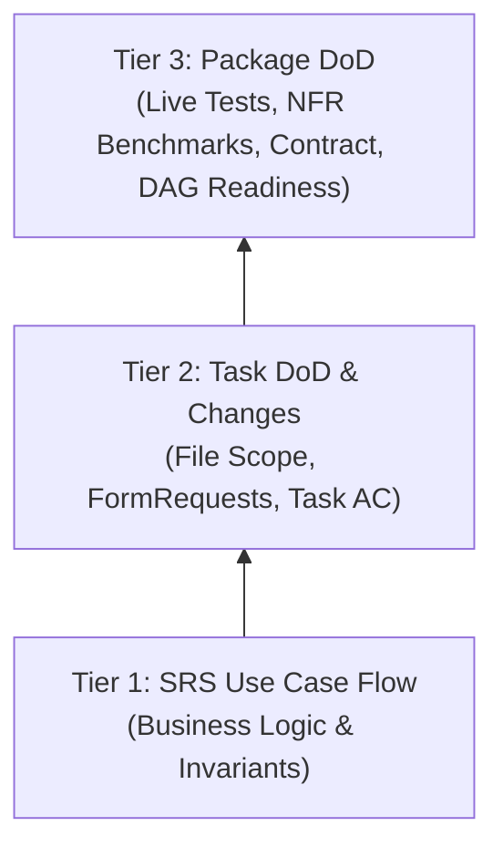

# Package QA/QC Protocol (Bidirectional Traceability & V-Model Verification)

> **Role**: Quality Assurance & Verification Methodology for Campus Event Hub (CEH) Phase 2 Work Packages.
> **Standard**: IEEE 830 / ISO 29148 Traceability & Dual-tier Verification.

---

## 1. Document Architecture & Roles (SSOT vs Execution Plans)

Before inspecting any work package, strictly distinguish the two document tiers:

```
┌────────────────────────────────────────────────────────────────────────┐
│                   TIER 1: SYSTEM SPECIFICATION SSOT                   │
│                     (The Immutable Source of Truth)                    │
├────────────────────────────────────────────────────────────────────────┤
│ • docs/srs_v3_1_3.md       -> Functional Requirements & 26 Use Cases   │
│ • docs/openapi_v3.2.3.yml  -> Authoritative API Contract & Envelopes   │
│ • docs/database_v3.1.2_... -> 24-Table 3NF Schema & Constraints        │
│ • .agents/memory/...       -> 5 Core Invariants & Lock Ordering Rules  │
└────────────────────────────────────────────────────────────────────────┘
                                   ▲
                                   │ Referenced by
┌────────────────────────────────────────────────────────────────────────┐
│                   TIER 2: EXECUTION & TASK PLANS                      │
│                      (The Tactical WBS & Plans)                        │
├────────────────────────────────────────────────────────────────────────┤
│ • docs/plans/Phase_2_Work_Packages.md -> 15 PKGs, DAG, Package DoD    │
│ • docs/plans/03_phase_2_domain_...md  -> 31 Task ACs, Files, UC Trace │
└────────────────────────────────────────────────────────────────────────┘
```

---

## 2. Phase 1: Forward Traceability Protocol (Package Ingestion)

When given a package identifier (e.g., `PKG-01`, `PKG-02`, ..., `PKG-15`):

```
Step 1: Input PKG-ID
   │
   ▼
Search `docs/plans/Phase_2_Work_Packages.md`
   ├─► Extract list of Technical Task IDs (e.g., CEH-P2-ROOM-01, CEH-P2-ROOM-02)
   ├─► Extract Package Prerequisites (DAG dependencies)
   └─► Extract Package Definition of Done (DoD) & Verification criteria
   │
   ▼
Search `docs/plans/03_phase_2_domain_features_and_business_logic.md`
   ├─► For each Task ID: Extract declared target files (Controllers, Services, Requests, Resources)
   ├─► Extract Task-level Acceptance Criteria (Task AC checklist)
   └─► Extract Mapped Use Case IDs and Functional Requirement IDs (e.g., UC-ROOM-01, FR-07)
   │
   ▼
Search `docs/srs_v3_1_3.md`
   ├─► Locate the corresponding Use Case sections
   ├─► Extract Actor goals, Pre-conditions, Post-conditions
   ├─► Extract Normal Course step sequence
   └─► Extract Alternative & Exception Courses (AC and EX scenarios)
   │
   ▼
Search `docs/openapi_v3.2.3.yml` & `docs/database_v3.1.2_mysql.sql`
   ├─► Verify endpoints: Path, HTTP Method, Query Parameters, Request Body, Response Schema
   └─► Verify DB constraints: Primary/Foreign keys, Unique pairs, CHECK constraints
```

---

## 3. Phase 2: Bottom-Up 3-Tier Verification Matrix (QA/QC Inspection)

Do NOT inspect code top-down. Inspect bottom-up from domain essence to package sign-off:



### Tier 1: SRS Use Case Flow (Core Business & Invariants)
1. **Actor Intent & Normal Course**: Does the implementation satisfy the Actor's operational goal without skipped steps?
2. **Alternative & Exception Courses**:
   - Are boundary collisions handled gracefully with proper HTTP status codes (400, 403, 404, 409, 422)?
   - Does any unhandled database exception leak a 500 error?
3. **Core Invariants & Edge Rules**:
   - Verify Deadlock-Free Lock Ordering: `tai_khoan -> phong_hoi_truong -> dat_phong -> su_kien -> dang_ky -> hang_doi_waitlist`.
   - Verify Capacity Invariants: No phantom bookings or capacity over-allocation.
   - Verify Buffer intervals (e.g., 15-minute room buffer) and threshold gates (e.g., T-4h cancellation lock, T-2h waitlist closure).

### Tier 2: Task DoD & Change Scope (`03_phase_2_...md`)
1. **Scope Conformance**:
   - Check `git diff origin/main...HEAD`.
   - Did the author modify or create all files specified in the task card?
   - Are there out-of-scope modifications that should belong to another package?
2. **FormRequest Authorization & Rules**:
   - Does `authorize()` enforce RBAC matching OpenAPI `x-roles`?
   - Do validation rules enforce database constraints (string length, enum bounds, composite unique pairs via `Rule::unique()`)?
3. **Task Acceptance Criteria**:
   - Walk through every checklist item `[ ]` in the Task card.
   - Demand concrete test cases demonstrating each criterion is satisfied.

### Tier 3: Package DoD (`Phase_2_Work_Packages.md`)
1. **Empirical Test Suite Execution**:
   - Run live tests inside the Docker environment:
     ```bash
     docker compose exec -T app php artisan test tests/Feature/[PackageTest].php
     ```
   - Assert zero failures and zero skipped tests.
2. **NFR Performance & Concurrency Benchmarks**:
   - If the package specifies NFRs (e.g., NFR-PERF-03 room availability < 50ms, NFR-PERF-02 50 concurrent users), execute the benchmark script.
   - Record empirical p50, p90, p95, p99, and Max latency metrics.
3. **API Contract & Envelope Consistency**:
   - Response envelope must match:
     - Success: `{ "success": true, "data": ..., "message": "..." }`
     - Error: `{ "success": false, "error": { "code": "...", "details": ... }, "message": "..." }`
   - Compare HTTP method (`GET` vs `POST`), route paths, and JSON resource keys against `docs/openapi_v3.2.3.yml`.
4. **DAG Downstream Readiness**:
   - Does this package expose all public APIs and services needed by downstream packages on the Critical Path?
   - Are RBAC middlewares overly restrictive (e.g., blocking `ToChuc` from viewing resources shared with `Admin`)?

---

## 4. Defect Triage & Severity Categorization

Group all identified defects into three standardized severity levels:

| Level | Classification | Impact | Example |
| :--- | :--- | :--- | :--- |
| 🔴 **P0** | **Blocker / Critical** | Breaks downstream packages, breaks core business rules, or causes 500 crashes / security bypass. **Blocks PR merge.** | RBAC middleware blocking `ToChuc` from selecting rooms; race conditions allowing capacity over-booking. |
| 🟡 **P1** | **Contract Deviation / Integrity** | Inconsistent with OpenAPI contract, missing DB unique validation, or schema naming mismatch. | Route registered as `POST` when OpenAPI specifies `GET`; JSON key named `available` instead of `kha_dung`. |
| 🟢 **P2** | **Quality & Hygiene** | Code smells, test pollution, missing docblocks, or minor styling discrepancies. | Benchmark script leaving uncleaned seed rows that fail regression tests; dead code. |

---

## 5. Standardized Markdown Audit Report Template

Every audit must produce a structured report saved to `docs/reports/{PKG-ID}_QA_QC_REPORT.md`:

```markdown
# QA/QC AUDIT REPORT: [PKG-ID] — [PACKAGE NAME]

> **Target**: Branch `[branch-name]` vs `origin/main` ([files changed] files, [lines] lines)
> **Auditor**: Lead QA/QC Engineer (`@package-qa-auditor`)
> **Date**: [YYYY-MM-DD]
> **SSOT References**: `docs/srs_v3_1_3.md`, `docs/plans/Phase_2_Work_Packages.md`, `docs/openapi_v3.2.3.yml`

## I. EXECUTIVE SUMMARY
[Status table across Core Business, NFRs, Data Integrity, RBAC, Contract, Test Coverage]

## II. BIDIRECTIONAL TRACEABILITY & VERIFICATION
### 1. Tier 1: SRS Use Case Alignment (Domain Essence)
### 2. Tier 2: Task-level DoD & AC Conformance
### 3. Tier 3: Package-level DoD & Downstream Readiness

## III. DEFECTS & FINDINGS
### 🔴 P0 - Blocker Issues
### 🟡 P1 - Contract Deviations & Data Integrity
### 🟢 P2 - Quality Improvements & Test Hygiene

## IV. EMPIRICAL VERIFICATION EVIDENCE
[Terminal logs of passing test suite and benchmark runs]

## V. VERDICT & ACTION CHECKLIST
[PASS or REJECT with actionable checkboxes for author]
```
