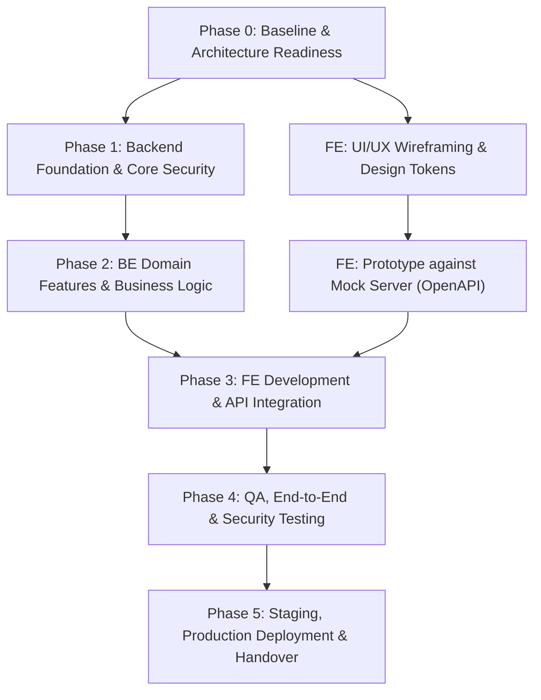

# Campus Event Hub (CEH) — Đánh Giá Khả Năng & Khung Kế Hoạch Tổng Thể (Master Roadmap)

> **Tài liệu chiến lược**: Đánh giá tính khả thi phát triển Backend song song và khung phân rã công việc (Work Breakdown Structure - WBS) từ Phase 0 đến Phase 5.  
> **Tác giả / Vai trò**: Tech Lead & Senior Project Manager  
> **Dự án**: Campus Event Hub (CEH Main Project) — IS207 UIT  
> **Thời điểm lập**: 2026-10-26  
> **Trạng thái**: Draft / Đã duyệt Skeleton  

---

## 1. ĐÁNH GIÁ KHẢ NĂNG TRIỂN KHAI BACKEND NGAY (FEASIBILITY ASSESSMENT)

### 1.1 Bối cảnh dự án
- **Tài liệu đã chuẩn bị**:
  - Đặc tả yêu cầu phần mềm: [`docs/srs_v3_1_3.md`](../srs_v3_1_3.md)
  - Thiết kế CSDL chi tiết (DDL): [`docs/database_v3.1.2_mysql.sql`](../database_v3.1.2_mysql.sql) & [`docs/database_design_v3.1.2.md`](../database_design_v3.1.2.md)
  - Đặc tả hợp đồng API: [`docs/openapi_v3.2.3.yml`](../openapi_v3.2.3.yml)
- **Tình trạng Frontend (FE)**: Đang trong giai đoạn thiết kế UI/UX (chưa bước vào viết code giao diện).
- **Yêu cầu**: Tiến hành triển khai Backend (BE) ngay lập tức nhằm đẩy nhanh tiến độ dự án.

### 1.2 Kết luận của Tech Lead / Senior PM
> **KẾT LUẬN: HOÀN TOÀN KHẢ THI VÀ LÀ THỰC HÀNH TỐT NHẤT (BEST PRACTICE - API-FIRST / CONTRACT-FIRST APPROACH).**

### 1.3 Cơ sở kỹ thuật & Lợi thế
1. **Single Source of Truth (SSOT) đã hoàn thiện**:
   - Backend không phụ thuộc vào việc giao diện trực quan trông như thế nào mà phụ thuộc vào **Hợp đồng dữ liệu (Data Contract)** và **Quy tắc nghiệp vụ (Business Rules)**.
   - `openapi_v3.2.3.yml` đã xác định rõ từng endpoint, HTTP verb, query params, request body, response structure, error schema và security schemes.
   - `database_v3.1.2_mysql.sql` đã khóa cấu trúc thực thể, khóa ngoại, chỉ mục và virtual columns.
2. **Tách rời độc lập (Decoupling BE & FE)**:
   - BE có thể dựng ngay tầng Database Migrations, Seeders, Core Architecture, Service Layer và Automated Tests.
   - FE trong quá trình vẽ UI/UX có thể kích hoạt Mock Server (Prism) dựa trên chính file OpenAPI để kiểm thử trải nghiệm người dùng (UX prototype) mà không bị phụ thuộc vào tiến độ BE.
3. **Môi trường Container hóa đã có sẵn**:
   - [`compose.yaml`](../../compose.yaml) đã cấu hình sẵn Laravel (PHP), MySQL 8.4 và Nginx.

### 1.4 Quản trị rủi ro (Risk Management Matrix)

| Rủi ro tiềm ẩn (Risk) | Mức độ | Kế hoạch giảm thiểu (Mitigation Strategy) |
| :--- | :---: | :--- |
| **UI thay đổi làm thay đổi API Contract** | Trung bình | **Change Management Process**: Mọi thay đổi về flow màn hình làm phát sinh thêm trường dữ liệu/filter phải được cập nhật vào OpenAPI spec trước, sau đó BE mới update code. |
| **Lệch Validation Rules giữa BE & FE** | Thấp | Lấy `srs_v3_1_3.md` và `openapi_v3.2.3.yml` làm quy chuẩn tham chiếu duy nhất. |
| **Thiếu kiểm thử thực tế khi chưa có UI** | Trung bình | BE bắt buộc triển khai Automated Integration Tests (PHPUnit/Pest) và bộ Postman/Bruno Collection để tự kiểm thử và nghiệm thu độc lập. |

---

## 2. KHUNG KẾ HOẠCH DỰ ÁN TỔNG THỂ (MASTER SKELETON WBS)

---

### 📌 Phase 0: Baseline & Architecture Readiness (Chuẩn bị & Đồng bộ)
* **Thời lượng dự kiến**: 3 – 5 ngày.
* **Mục tiêu**: Đóng băng baseline tài liệu hiện tại, đồng bộ môi trường dev cục bộ, dựng Mock Server và thiết lập quy trình kiểm soát chất lượng (Linters, Git Rules, Conventions).
* **Deliverable**: Môi trường Dev chạy ổn định, tài liệu baseline được duyệt, Mock Server sẵn sàng.

---

### 📌 Phase 1: BE Foundation & Authentication (Nền tảng kỹ thuật & Phân quyền)
*(Tiến hành song song: FE tập trung chốt Design System & Wireframes/Hi-fi Prototype trên Figma)*
* **Thời lượng dự kiến**: 1 – 2 tuần.
* **Mục tiêu**: Xây dựng bộ khung Backend vững chắc, cơ chế xác thực, phân quyền (RBAC) và các module tiện ích dùng chung.
* **Work Packages chính**:
  - **WP1.1 Database Migration & Seeding**: Chuyển đổi DDL SQL thành Laravel Migrations & Seeders (roles, admin, faculties, categories).
  - **WP1.2 Core Architecture**: Base Controller, FormRequest/Validator, API Response Transformer (Unified Envelope), Global Exception Handler.
  - **WP1.3 Auth & Security**: Laravel Sanctum (Single Active Session), HttpOnly Cookie, Refresh Token, Forgot Password, Middleware phân quyền (Student, Organizer, Staff, Admin).
  - **WP1.4 Common Services**: Logging, File Upload Service (Cloudinary/Local S3), Email Notification Service (SMTP template).
* **Deliverable**: Auth APIs hoàn chỉnh, khung kiến trúc chuẩn, DB migration chạy mượt mà trên môi trường sạch.

---

### 📌 Phase 2: BE Domain Features & Business Logic (Triển khai các phân hệ nghiệp vụ)
*(Tiến hành song song: FE bắt đầu dựng khung HTML/CSS Layout và Component Lib)*
* **Thời lượng dự kiến**: 2 – 3 tuần.
* **Mục tiêu**: Hoàn thiện toàn bộ logic nghiệp vụ cốt lõi của Campus Event Hub trên BE.
* **Work Packages chính**:
  - **WP2.1 Event Management Module**: CRUD sự kiện, kiểm duyệt sự kiện (Approval Workflow), lọc/tìm kiếm, gắn tag, quản lý địa điểm/khoa.
  - **WP2.2 Ticket & Registration Module**: Đăng ký vé sự kiện, giới hạn số lượng, mã vé QR Code HMAC-SHA256, danh sách người tham gia, hủy vé ($T - 4\text{h}$), hàng đợi Waitlist ($T - 2\text{h}$).
  - **WP2.3 Attendance & Check-in Module**: Kiosk dynamic QR Code (TOTP RFC 6238), quét QR Check-in/Check-out, ghi nhận điểm rèn luyện / chứng chỉ tham gia.
  - **WP2.4 Feedback & Q&A / Interaction**: Đánh giá sự kiện, khảo sát sau sự kiện, hỏi đáp tương tác.
  - **WP2.5 Administration & Reporting**: Dashboard thống kê sự kiện, xuất báo cáo CSV/PDF, quản trị người dùng.
* **Deliverable**: 100% API Endpoints hoàn thành, kèm Automated Integration Tests và Postman Collection.

---

### 📌 Phase 3: Frontend Development & API Integration (Xây dựng giao diện & Tích hợp)
* **Thời lượng dự kiến**: 2 – 3 tuần.
* **Mục tiêu**: Ghép nối giao diện người dùng với hệ thống Backend thực tế.
* **Work Packages chính**:
  - **WP3.1 UI Implementation**: Xây dựng các trang (Landing page, Event catalog, Event details, Auth modal, Organizer Portal, Admin Dashboard).
  - **WP3.2 State Management & API Client**: Cấu hình HTTP Client (Axios/Fetch), Interceptors (tự động đính kèm token, xử lý refresh token, thông báo lỗi).
  - **WP3.3 Flow Integration**: Tích hợp luồng Đăng nhập -> Duyệt sự kiện -> Đăng ký nhận vé QR -> Check-in -> Xem lịch sử/chứng nhận.
  - **WP3.4 Responsive & UX Tuning**: Tối ưu hiển thị Mobile/Tablet/Desktop, trạng thái loading, empty-state, skeleton loaders.
* **Deliverable**: Ứng dụng Web hoàn chỉnh hoạt động end-to-end với dữ liệu thật từ Backend.

---

### 📌 Phase 4: Quality Assurance & Hardening (Kiểm thử, Tối ưu & Bảo mật)
* **Thời lượng dự kiến**: 1 – 2 tuần.
* **Mục tiêu**: Đảm bảo chất lượng phần mềm, hiệu năng chịu tải và an toàn bảo mật trước khi phát hành.
* **Work Packages chính**:
  - **WP4.1 End-to-End Functional Testing**: Kiểm thử toàn diện các luồng nghiệp vụ chính theo 32 Use Cases trong SRS.
  - **WP4.2 Concurrency & Stress Testing**: Giả lập kịch bản đăng ký vé số lượng lớn cùng thời điểm (xác thực Deadlock-free Lock Ordering và chống Overbooking).
  - **WP4.3 Security & Vulnerability Check**: Kiểm tra bảo mật (SQL Injection, XSS, CSRF, IDOR / Broken Object Level Authorization trên API).
  - **WP4.4 Bug Fixing & Optimization**: Fix issues, tối ưu hóa câu truy vấn CSDL (chống N+1 query, tối ưu index).
* **Deliverable**: Báo cáo kiểm thử (QA Report), hệ thống đạt chỉ tiêu ổn định và bảo mật.

---

### 📌 Phase 5: Deployment, Staging & Production Go-Live (Triển khai & Bàn giao)
* **Thời lượng dự kiến**: 1 tuần.
* **Mục tiêu**: Triển khai hệ thống lên môi trường production và bàn giao tài liệu kỹ thuật.
* **Work Packages chính**:
  - **WP5.1 CI/CD Pipeline Setup**: Tự động hóa build, test, deploy qua GitHub Actions / Docker.
  - **WP5.2 Server & Production Provisioning**: Cấu hình Web Server (Nginx, SSL/TLS Let's Encrypt), CSDL Production, Backup Cronjob.
  - **WP5.3 UAT & Data Seeding**: Kiểm thử chấp nhận người dùng (User Acceptance Testing) và nạp dữ liệu ban đầu.
  - **WP5.4 Handover Documentation**: Cập nhật tài liệu kỹ thuật, hướng dẫn vận hành, deployment runbook.
* **Deliverable**: Hệ thống online chính thức, tài liệu bàn giao đầy đủ.
