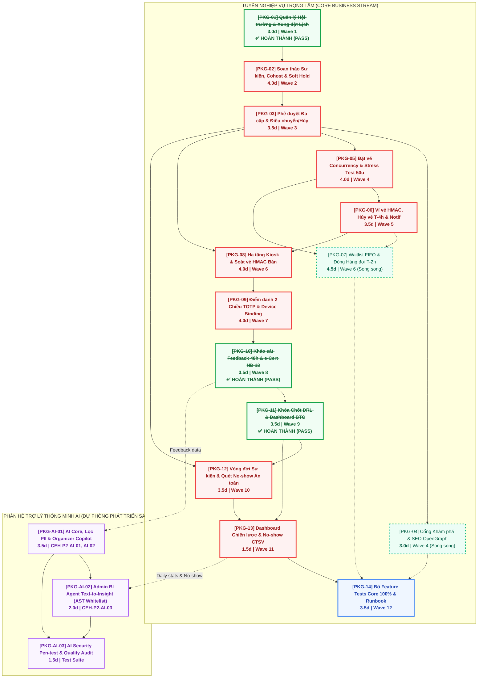

# Campus Event Hub (CEH) — Kế Hoạch Đóng Gói Công Việc (Work Packages - WP) Phase 2

> **Dự án**: Campus Event Hub (CEH Main Project) — IS207 UIT
>
> **Tài liệu**: Đặc tả các Gói Công Việc (Work Packages - WP) và Lập lịch Thực thi theo Đồ thị Phụ thuộc (Work Dependency DAG)
>
> **Phiên bản**: v1.0
>
> **Vai trò thực hiện**: Senior Technical Project Manager kiêm Software Architect (`@project-planner` phối hợp `@orchestrator`)
>
> **Căn cứ kỹ thuật (SSOT)**:
>
> 1. `docs/plan/Phase_2_v1.md` (Work Breakdown 31 Tasks, Spec Tracing, Effort từng task).
> 2. `.agents/memory/project-conventions.md` (5 Bất biến cốt lõi, Lock Ordering, Chuẩn API Envelope).
> 3. `.agents/rules/test-integrity-harness.md` (Quy chuẩn kiểm thử và chống gian lận kiểm thử).
> 4. `docs/srs_v3_1_3.md` (FR-07 $\rightarrow$ FR-32, 26 Use Cases chi tiết).
> 5. `docs/database_v3.1.2_mysql.sql` (24 bảng 3NF, 3 Views: `v_event_analytics`, `v_feedback_an_danh`, `v_danh_sach_drl`).
> 6. `docs/openapi_v3.2.3.yml` (API Contract 40+ endpoints Phase 2).

---

## TỔNG QUAN PHÂN TÍCH VÀ ĐÓNG GÓI NGHIỆP VỤ (PHIÊN BẢN ĐIỀU CHỈNH CHIẾN LƯỢC)

Theo quyết định chiến lược mới của Ban Quản Trị Dự Án:
1. **Ưu tiên Tối thượng cho Nghiệp vụ Cốt lõi (Core Business Fast-Track)**:
   - Toàn bộ năng lực lập trình và tài nguyên dự án được tập trung giải quyết triệt để luồng vận hành thực tế: Máy trạng thái vòng đời sự kiện tự động, tác vụ quét No-show an toàn, gom thống kê CSDL và Dashboard báo cáo chiến lược toàn trường cho BGH / P.CTSV.
   - Hoàn tất và nghiệm thu toàn diện bộ kiểm thử 100% Use Cases nghiệp vụ Core để bàn giao phiên bản **CampusEventHub Production Core MVP** đưa vào sử dụng thực tế tại UIT.
2. **Tách rời Hoàn toàn Phân hệ AI (AI Subsystem Decoupling)**:
   - Các tính năng AI (Nền tảng AI Core, Lọc PII Nghị định 13, Trợ lý BTC Organizer Copilot, Admin BI Agent Text-to-Insight) được **bóc tách 100% ra khỏi Đường găng (Critical Path)** và chuyển vào phân hệ riêng (**Phase 2.B**).
   - Phân hệ AI sẽ được triển khai sau khi hoàn tất toàn bộ luồng nghiệp vụ chính, bảo đảm không gây rủi ro phụ thuộc bên thứ ba hay làm chậm trễ tiến độ bàn giao hệ thống Core.

---

## BẢNG THEO DÕI TIẾN ĐỘ THỰC HIỆN CÁC GÓI CÔNG VIỆC (PROGRESS CHECKLIST)

> **Trạng thái tổng quan Phase 2 (Cập nhật sau PKG-11)**:
> - **Tiến độ Luồng Nghiệp vụ Cốt lõi (Core Business)**: **11 / 14 gói hoàn thành (78.6%)**
> - **Khối lượng Effort Core đã hoàn thành**: **40.5d / 49.0d (82.7%)**
> - **Khối lượng Effort Core còn lại**: **8.5d** (Gồm: PKG-12: 3.5d, PKG-13: 1.5d, PKG-14: 3.5d)
> - **Gói đang kích hoạt / Kế tiếp**: **`PKG-12` (Wave 10 - Critical Path)**

### 1. BẢNG TIẾN ĐỘ LUỒNG NGHIỆP VỤ CỐT LÕI (CORE BUSINESS STREAM: PKG-01 $\rightarrow$ PKG-14)

| Tiến độ | Gói ID | Tên Gói Công Việc | Wave | Effort | Phân loại Lập lịch | Báo cáo Nghiệm thu QA/QC | Trạng thái Nghiệp vụ & Kỹ thuật |
| :---: | :--- | :--- | :---: | :---: | :---: | :--- | :--- |
| [x] | **`PKG-01`** | Quản lý Hội trường & Xung đột Lịch (15p Buffer) | Wave 1 | **3.0d** | Critical Path | [`PKG-01_QA_QC_REPORT.md`](../reports/PKG-01_QA_QC_REPORT.md) | ✅ **PASS** (14/14 tests pass, p95=5.22ms, Đã sáp nhập `main`) |
| [x] | **`PKG-02`** | Soạn thảo Sự kiện, Đồng tổ chức & Soft Hold 48h | Wave 2 | **4.0d** | Critical Path | [`PKG-02_QA_QC_REPORT.md`](../reports/PKG-02_QA_QC_REPORT.md) | ✅ **PASS** (20/20 tests pass, Đã sáp nhập `main`) |
| [x] | **`PKG-03`** | Động cơ Duyệt Đa cấp & Điều chuyển / Hủy Khẩn cấp | Wave 3 | **3.5d** | Critical Path | [`PKG-03_QA_QC_REPORT.md`](../reports/PKG-03_QA_QC_REPORT.md) | ✅ **PASS** (20/20 tests pass, Đã sáp nhập `main`) |
| [x] | **`PKG-04`** | Cổng Khám phá Sự kiện Công khai & OpenGraph SSR | Wave 4 | **3.0d** | Song song | [`PKG-04_QA_QC_REPORT.md`](../reports/PKG-04_QA_QC_REPORT.md) | ✅ **PASS** (16/16 tests pass, p95=6.74ms, Đã sáp nhập `main`) |
| [x] | **`PKG-05`** | Động cơ Đặt vé Concurrency & Stress Test 50 Users | Wave 4 | **4.0d** | Critical Path | [`PKG-05_QA_QC_REPORT.md`](../reports/PKG-05_QA_QC_REPORT.md) | ✅ **PASS** (13/13 tests pass, 50u stress pass, Đã sáp nhập `main`) |
| [x] | **`PKG-06`** | Ví Vé Cá nhân, Quản lý Hủy vé T-4h & Thông báo | Wave 5 | **3.5d** | Critical Path | [`PKG-06_QA_QC_REPORT.md`](../reports/PKG-06_QA_QC_REPORT.md) | ✅ **PASS** (22/22 tests pass, Đã sáp nhập `main`) |
| [x] | **`PKG-07`** | Hàng đợi Waitlist FIFO, Cấp Offer & Đóng T-2h | Wave 6 | **4.5d** | Song song | [`PKG-07_QA_QC_REPORT.md`](../reports/PKG-07_QA_QC_REPORT.md) | ✅ **PASS** (17/17 tests pass, Đã sáp nhập `main`) |
| [x] | **`PKG-08`** | Hạ tầng Phiên Kiosk Độc lập & Soát vé HMAC Bàn | Wave 6 | **4.0d** | Critical Path | [`PKG-08_QA_QC_REPORT.md`](../reports/PKG-08_QA_QC_REPORT.md) | ✅ **PASS** (19/19 tests pass, Đã sáp nhập `main`) |
| [x] | **`PKG-09`** | Điểm danh 2 Chiều TOTP, Device Binding & $\Delta t$ | Wave 7 | **4.0d** | Critical Path | [`PKG-09_QA_QC_REPORT.md`](../reports/PKG-09_QA_QC_REPORT.md) | ✅ **PASS** (21/21 tests pass, Đã sáp nhập `main`) |
| [x] | **`PKG-10`** | Khảo sát Feedback 48h & e-Certificate NĐ 13 | Wave 8 | **3.5d** | Critical Path | [`PKG-10_QA_QC_REPORT.md`](../reports/PKG-10_QA_QC_REPORT.md) | ✅ **PASS** (26/26 tests pass, Đã sáp nhập `main`) |
| [x] | **`PKG-11`** | Khóa Chốt Điểm Rèn Luyện & Dashboard BTC | Wave 9 | **3.5d** | Critical Path | [`PKG-11_QA_QC_REPORT.md`](../reports/PKG-11_QA_QC_REPORT.md) | ✅ **PASS** (26/26 tests pass, Đã sáp nhập `main`) |
| [ ] | **`PKG-12`** | Máy Trạng thái Vòng đời, Quét No-show & Gom Thống kê | Wave 10 | **3.5d** | Critical Path | — | ⏳ **Sẵn sàng thực thi ngay** (Mở khóa bởi PKG-11) |
| [ ] | **`PKG-13`** | Dashboard Báo cáo Chiến lược Toàn trường & Giám sát No-show | Wave 11 | **1.5d** | Critical Path | — | ⬜ Chờ PKG-11, PKG-12 hoàn tất |
| [ ] | **`PKG-14`** | Bộ Feature Tests 100% Use Cases Core & Runbook Nghiệm thu | Wave 12 | **3.5d** | Critical Path Gate | — | ⬜ Chờ toàn bộ PKG-01 $\rightarrow$ PKG-13 hoàn tất |
| **TỔNG** | **14 Gói** | **Đường găng Core: 49.0d (Single-dev: 49.0d)** | **12 Waves** | **49.0d** | — | **11/14 Gói có Báo cáo QA** | **Hoàn thành: 11/14 (78.6%) \| Effort: 40.5d/49.0d (82.7%)** |

---

### 2. BẢNG PHÂN HỆ TRỢ LÝ THÔNG MINH AI (AI EXTENSION SUBSYSTEM - DỰ PHÒNG TRIỂN KHAI SAU)

> Phân hệ này được tách độc lập hoàn toàn khỏi luồng nghiệp vụ chính, bảo đảm không chặn đứng bất kỳ cột mốc golive nào của hệ thống.

| Gói ID | Tên Gói Công Việc | Danh sách Tasks | Effort | Phụ thuộc Gói | Mục tiêu & Giá trị Gia tăng |
| :--- | :--- | :--- | :---: | :--- | :--- |
| **`PKG-AI-01`** | Nền tảng AI Core, Lọc PII & Trợ lý BTC Organizer Copilot | `CEH-P2-AI-01CEH-P2-AI-02` | **3.5d** | `PKG-10` *(Đã có)*, `PKG-14` *(Core ổn định)* | Làm sạch 100% PII theo NĐ 13, phòng vệ Prompt Injection, hỗ trợ BTC soạn nội dung & tóm tắt ý kiến khảo sát. |
| **`PKG-AI-02`** | Trợ lý Quản trị Admin BI Agent Text-to-Insight | `CEH-P2-AI-03` | **2.0d** | `PKG-AI-01`, `PKG-13` *(Bảng thống kê ngày)* | Dịch câu hỏi tiếng Việt thành SQL chỉ đọc an toàn (AST Whitelist, `LIMIT 50`) phục vụ BGH / P.CTSV. |
| **`PKG-AI-03`** | Kiểm thử Đánh giá An toàn AI & Thẩm định Bảo mật Prompt | AI Test Suite & Pen-test | **1.5d** | `PKG-AI-01`, `PKG-AI-02` | Kiểm thử hộp đen PII leakage, phòng thủ Prompt Injection / Jailbreak và đo lường độ trễ LLM. |
| **TỔNG AI** | **3 Gói** | **Phân hệ Mở rộng AI Độc lập** | **7.0d** | — | **Triển khai sau khi hoàn thành và bàn giao xong 100% Core Business.** |

---

## PHẦN I: SƠ ĐỒ ĐỒ THỊ PHỤ THUỘC TỔNG THỂ (MERMAID DAG)

Sơ đồ thể hiện trực quan quan hệ phụ thuộc giữa **Tuyến Nghiệp vụ Trọng tâm (Core Business Stream - 14 Gói)** và **Phân hệ Trợ lý Thông minh AI (AI Extension Subsystem - 3 Gói Dự phòng)**.

- **Viền xanh lá nét liền (`completed`) kèm chữ gạch ngang (`<s>...</s>`)**: Gói đã **Hoàn thành & Nghiệm thu QA/QC PASS**.
- **Viền đỏ nét liền đậm (`criticalPath`)**: Gói nằm trên **Đường găng Core Business** — quyết định tiến độ bàn giao sản phẩm.
- **Viền xanh nét đứt (`parallelTrack`)**: Gói **Có thể chạy song song độc lập (Parallelizable)** khi có thêm tài nguyên lập trình viên.
- **Viền xanh dương đậm (`finalHarness`)**: Lưới an toàn kiểm thử tự động toàn diện chốt chặn cuối cùng (Verification Gate).
- **Màu tím nhạt (`aiTrack`)**: Phân hệ Trợ lý AI tách biệt, sẵn sàng triển khai độc lập sau khi hoàn tất Core.



---

## PHẦN II: BẢNG TỔNG HỢP CÁC GÓI CÔNG VIỆC (SUMMARY TABLES)

### 1. Tuyến Nghiệp vụ Trọng tâm (Core Business Stream - 14 Gói Công Việc)

| Gói ID       | Tên Gói Công Việc                                              | Danh sách Task IDs                          | Tổng Effort | Phụ thuộc Gói (Prerequisites)       | Mức độ Song song (Parallelism)                            | Wave Thực thi |
| ------------ | -------------------------------------------------------------- | ------------------------------------------- | ----------- | ----------------------------------- | --------------------------------------------------------- | ------------- |
| **`PKG-01`** | Quản lý Hội trường & Động cơ Xung đột Lịch (15p Buffer)        | `CEH-P2-ROOM-01CEH-P2-ROOM-02`              | **3.0d**    | Không (Phase 1 Foundation)          | **Critical Path** (Chặn toàn bộ tạo lịch phòng)           | **Wave 1**    |
| **`PKG-02`** | Soạn thảo Sự kiện, Đồng tổ chức & Quản lý Soft Hold 48h        | `CEH-P2-EVT-01CEH-P2-EVT-02`                | **4.0d**    | `PKG-01`                            | **Critical Path** (Chặn luồng duyệt sự kiện)              | **Wave 2**    |
| **`PKG-03`** | Động cơ Duyệt Đa cấp Host-driven & Điều chuyển / Hủy Khẩn cấp  | `CEH-P2-EVT-03CEH-P2-EVT-04`                | **3.5d**    | `PKG-02`                            | **Critical Path** (Cột mốc duyệt mở đăng ký)              | **Wave 3**    |
| **`PKG-04`** | Cổng Khám phá Sự kiện Công khai & Thẻ Meta OpenGraph SSR       | `CEH-P2-DISC-01CEH-P2-DISC-02`              | **3.0d**    | `PKG-03`                            | **Song song** với PKG-05 (Slack = 26.5d)                  | **Wave 4**    |
| **`PKG-05`** | Động cơ Đặt vé Concurrency & Bộ Kiểm thử Chịu tải 50 Users     | `CEH-P2-BOOK-01CEH-P2-TST-02`               | **4.0d**    | `PKG-03`                            | **Critical Path** (Trọng tâm giao dịch tương tranh)       | **Wave 4**    |
| **`PKG-06`** | Ví Vé Cá nhân, Quản lý Hủy vé T-4h & Trung tâm Thông báo       | `CEH-P2-TCK-01CEH-P2-TCK-02CEH-P2-NOTIF-01` | **3.5d**    | `PKG-05`                            | **Critical Path** (Cung cấp vé số hóa cho Kiosk)          | **Wave 5**    |
| **`PKG-07`** | Hàng đợi Waitlist FIFO, Cấp Offer & Bộ Chốt Đóng Waitlist T-2h | `CEH-P2-BOOK-02CEH-P2-SYS-02`               | **4.5d**    | `PKG-05`, `PKG-06`                  | **Song song** với PKG-08 (Slack = 17.5d)                  | **Wave 6**    |
| **`PKG-08`** | Hạ tầng Phiên Kiosk Độc lập & Soát vé HMAC Bàn Đón tiếp        | `CEH-P2-OPS-01CEH-P2-OPS-02`                | **4.0d**    | `PKG-03`, `PKG-06`                  | **Critical Path** (Khởi động luồng điểm danh)             | **Wave 6**    |
| **`PKG-09`** | Điểm danh 2 Chiều TOTP, Device Binding & Nhật ký Cứu xét       | `CEH-P2-OPS-03CEH-P2-OPS-04`                | **4.0d**    | `PKG-08`                            | **Critical Path** (Tính $\Delta t$ để xét ĐRL/Feedback)   | **Wave 7**    |
| **`PKG-10`** | Khảo sát Đánh giá 48h & Cấp Chứng nhận số e-Certificate HMAC   | `CEH-P2-FEED-01CEH-P2-CERT-01`              | **3.5d**    | `PKG-09`                            | **Critical Path** (Điều kiện cần để khóa chốt ĐRL)        | **Wave 8**    |
| **`PKG-11`** | Khóa Chốt Điểm Rèn Luyện & Dashboard Vận hành Sự kiện BTC      | `CEH-P2-DRL-01CEH-P2-REP-01`                | **3.5d**    | `PKG-10`                            | **Critical Path** (Bàn giao biểu mẫu CTSV)                | **Wave 9**    |
| **`PKG-12`** | Máy Trạng thái Vòng đời, Quét No-show An toàn & Gom Thống kê   | `CEH-P2-SYS-01CEH-P2-SYS-03`                | **3.5d**    | `PKG-03`, `PKG-11`                  | **Critical Path** (Cập nhật bảng `thong_ke_su_kien_ngay`) | **Wave 10**   |
| **`PKG-13`** | Dashboard Báo cáo Chiến lược Toàn trường & Giám sát No-show    | `CEH-P2-REP-02`                             | **1.5d**    | `PKG-11`, `PKG-12`                  | **Critical Path** (Hoàn thiện phân hệ Báo cáo Vĩ mô CTSV) | **Wave 11**   |
| **`PKG-14`** | Bộ Feature Tests 100% Use Cases Nghiệp vụ Core & Runbook       | `CEH-P2-TST-01CEH-P2-TST-03`                | **3.5d**    | Toàn bộ PKG-01 $\rightarrow$ PKG-13 | **Critical Path Gate** (Nghiệm thu đóng Core Business)    | **Wave 12**   |
| **TỔNG CORE** | **14 Gói** | **Đường găng: 39.5d (Single-dev: 49.0d)** | **12 Waves** | **49.0d** | — | **3/14 Gói có Báo cáo QA** | **Hoàn thành: 3/14 (21.4%) | Effort: 10.0d/49.0d (20.4%)** |

> 💡 **Khối lượng Core còn lại từ PKG-12**: Chỉ còn **3 Gói (`PKG-12` + `PKG-13` + `PKG-14`)** với tổng effort **8.5 ngày** để đưa toàn bộ Core Business về đích và nghiệm thu bàn giao!

---

### 2. Phân hệ Trợ lý Thông minh AI (AI Extension Subsystem - 3 Gói Dự phòng)

| Gói ID          | Tên Gói Công Việc                                              | Danh sách Task IDs            | Tổng Effort | Phụ thuộc Gói (Prerequisites)                   | Phạm vi Nghiệp vụ / An toàn                                       |
| --------------- | -------------------------------------------------------------- | ----------------------------- | ----------- | ----------------------------------------------- | ------------------------------------------------------------------ |
| **`PKG-AI-01`** | Nền tảng AI Core, Lọc PII & Trợ lý BTC Organizer Copilot       | `CEH-P2-AI-01CEH-P2-AI-02`    | **3.5d**    | `PKG-10` *(Feedback data)*, `PKG-14` *(Core OK)*| Làm sạch 100% PII theo NĐ 13, chống Prompt Injection, Copilot BTC. |
| **`PKG-AI-02`** | Trợ lý Quản trị Admin BI Agent Text-to-Insight (AST Whitelist) | `CEH-P2-AI-03`                | **2.0d**    | `PKG-AI-01`, `PKG-13` *(Bảng thống kê ngày)*    | Dịch câu hỏi tự nhiên thành SQL chỉ đọc an toàn (`LIMIT 50`).      |
| **`PKG-AI-03`** | Kiểm thử Đánh giá An toàn AI & Thẩm định Bảo mật Prompt        | AI Test Suite & Pen-test      | **1.5d**    | `PKG-AI-01`, `PKG-AI-02`                        | Pen-test Prompt Injection, PII Leakage và đo lường độ trễ LLM.    |
| **TỔNG AI**     | **3 Gói**                                                      | **Phân hệ Mở rộng Độc lập**   | **7.0d**    | —                                               | **Kích hoạt sau khi Core bàn giao hoàn tất.**                      |

---

## PHẦN III: CHI TIẾT TỪNG GÓI CÔNG VIỆC (WORK PACKAGE CARDS)

---

### [PKG-01] Quản lý Phòng Hội trường & Động cơ Xung đột Lịch (15p Buffer)

1. **Mục tiêu kỹ thuật (Goal)**: Xây dựng nền móng phân hệ cơ sở vật chất, cho phép quản lý vòng đời phòng hội trường và lịch bảo trì. Hiện thực hóa thuật toán kiểm tra xung đột thời gian thực tích hợp đệm an toàn 15 phút ($< 50\text{ms}$) và tự động loại trừ Soft Hold quá hạn.
2. **Danh sách Task chi tiết**:
   - `CEH-P2-ROOM-01` - CRUD Quản lý Hội trường & Cấu hình Lịch bảo trì (1.5d).
   - `CEH-P2-ROOM-02` - Động cơ Tra cứu Lịch phòng & Kiểm tra Xung đột Thời gian thực (Buffer 15p) (1.5d).
   - _Files cốt lõi tác động_:
     - `app/Http/Controllers/Api/RoomController.php`
     - `app/Services/RoomService.php`
     - `app/Services/RoomScheduleService.php`
     - `app/Http/Requests/StoreRoomRequest.php`
     - `app/Http/Requests/UpdateRoomRequest.php`
     - `app/Http/Requests/CheckRoomAvailabilityRequest.php`
     - `app/Http/Resources/RoomResource.php`
     - `app/Http/Resources/RoomScheduleResource.php`
3. **Điều kiện tiên quyết (Hard Prerequisites)**: Hoàn tất Phase 1 Foundation (Authentication Sanctum, Database Migrations `phong_hoi_truong`, `dat_phong`).
4. **Khả năng song song (Parallel Readiness)**: Bắt đầu ngay tại Wave 1. Nằm trên **Critical Path**.
5. **Tiêu chí nghiệm thu gói (Package DoD & Verification)**:
   - Chạy kiểm thử: `php artisan test tests/Feature/RoomManagementTest.php`.
   - API `POST /rooms/{id}/availability` phát hiện chính xác va chạm lịch cách nhau dưới 15 phút và phản hồi trong $\le 50\text{ms}$.
   - Tuân thủ Envelope `{ success: true, data: { ... }, message: "..." }`.

---

### [PKG-02] Soạn thảo Sự kiện, Đồng tổ chức & Quản lý Soft Hold 48h

1. **Mục tiêu kỹ thuật (Goal)**: Hiện thực hóa quy trình khởi tạo sự kiện từ bản nháp `DRAFT`, cấu hình mở slot hoặc mở tự do, kiểm soát sức chứa tối đa theo phòng. Kích hoạt cơ chế gửi đề xuất, quản lý đồng thuận đồng tổ chức và giữ phòng tạm thời 48h (Soft Hold).
2. **Danh sách Task chi tiết**:
   - `CEH-P2-EVT-01` - Soạn thảo Sự kiện, Cấu hình Slot / Mở tự do & Quản lý Lời mời Đồng tổ chức (2.0d).
   - `CEH-P2-EVT-02` - Quy trình Đồng thuận Đồng tổ chức, Soft Hold 48h & Rút Đề xuất Sự kiện (2.0d).
   - _Files cốt lõi tác động_:
     - `app/Http/Controllers/Api/EventOrganizerController.php`
     - `app/Http/Controllers/Api/EventCoHostController.php`
     - `app/Services/EventDraftService.php`
     - `app/Services/EventProposalService.php`
     - `app/Http/Requests/StoreEventDraftRequest.php`
     - `app/Http/Requests/UpdateEventDraftRequest.php`
     - `app/Http/Requests/RespondCoHostRequest.php`
     - `app/Http/Requests/WithdrawProposalRequest.php`
     - `app/Http/Resources/EventResource.php`
3. **Điều kiện tiên quyết (Hard Prerequisites)**: `PKG-01` (Cần API & Service kiểm tra xung đột phòng).
4. **Khả năng song song (Parallel Readiness)**: Bắt đầu tại Wave 2 sau khi PKG-01 nghiệm thu. Nằm trên **Critical Path**.
5. **Tiêu chí nghiệm thu gói (Package DoD & Verification)**:
   - Tạo sự kiện nháp thành công; từ chối nếu `so_luong_toi_da > suc_chua_toi_da` của phòng.
   - Khi nộp đề xuất có đồng tổ chức, `dat_phong` sinh bản ghi `TAM_GIU` với hạn chót chính xác sau 48 giờ.
   - 1 đơn vị từ chối thì sự kiện lập tức rơi về `DRAFT` và giải phóng phòng.

---

### [PKG-03] Động cơ Duyệt Đa cấp Host-driven & Điều chuyển / Hủy Khẩn cấp

1. **Mục tiêu kỹ thuật (Goal)**: Xây dựng bộ quy tắc phân quyền phê duyệt theo cấp quản lý (CLB trực thuộc Khoa $\rightarrow$ Duyệt Khoa; Đơn vị cấp Trường $\rightarrow$ Duyệt P.CTSV), hỗ trợ Admin duyệt thay khẩn cấp, cơ chế yêu cầu chỉnh sửa/reopen và giao dịch hủy sự kiện khẩn cấp bảo đảm an toàn Deadlock.
2. **Danh sách Task chi tiết**:
   - `CEH-P2-EVT-03` - Động cơ Phê duyệt Đa cấp Host-driven, Admin Duyệt thay & Nhật ký Kiểm duyệt (2.0d).
   - `CEH-P2-EVT-04` - Quy trình Hủy Sự kiện Khẩn cấp & Điều chuyển Phòng Hội trường (1.5d).
   - _Files cốt lõi tác động_:
     - `app/Http/Controllers/Api/EventReviewController.php`
     - `app/Http/Controllers/Api/EventEmergencyController.php`
     - `app/Services/EventApprovalService.php`
     - `app/Services/EventEmergencyService.php`
     - `app/Http/Requests/ReviewEventRequest.php`
     - `app/Http/Requests/EmergencyCancelRequest.php`
     - `app/Http/Requests/ChangeRoomRequest.php`
     - `app/Http/Resources/ReviewQueueResource.php`
3. **Điều kiện tiên quyết (Hard Prerequisites)**: `PKG-02` (Cần đề xuất sự kiện và danh sách đơn vị tham gia).
4. **Khả năng song song (Parallel Readiness)**: Bắt đầu tại Wave 3. Nằm trên **Critical Path**.
5. **Tiêu chí nghiệm thu gói (Package DoD & Verification)**:
   - Cán bộ Khoa này không thể duyệt sự kiện của Khoa khác (HTTP 403 Forbidden).
   - Admin duyệt thay ghi đúng mã `APPROVE_FACULTY_BY_ADMIN` trong `nhat_ky_kiem_duyet`.
   - Hủy sự kiện chuyển trạng thái nguyên tử phòng, vé và waitlist theo đúng thứ tự khóa: `phong_hoi_truong -> dat_phong -> su_kien -> dang_ky -> hang_doi_waitlist`.

---

### [PKG-04] Cổng Khám phá Sự kiện Công khai & Thẻ Meta OpenGraph SSR

1. **Mục tiêu kỹ thuật (Goal)**: Xây dựng cổng tra cứu và lọc sự kiện công khai tối ưu hóa tìm kiếm Full-Text dưới $150\text{ms}$, cung cấp dữ liệu OpenGraph cho chia sẻ mạng xã hội và phân giải động trạng thái nút bấm theo ngữ cảnh sinh viên.
2. **Danh sách Task chi tiết**:
   - `CEH-P2-DISC-01` - Động cơ Tìm kiếm Fulltext Nâng cao & Lọc Sự kiện Đa tiêu chí (1.5d).
   - `CEH-P2-DISC-02` - Chi tiết Sự kiện Công khai, Thẻ Meta OpenGraph SSR & Bộ Phân giải Nút bấm Động (1.5d).
   - _Files cốt lõi tác động_:
     - `app/Http/Controllers/Api/EventCatalogController.php`
     - `app/Http/Controllers/Api/EventDetailController.php`
     - `app/Services/EventSearchService.php`
     - `app/Services/EventDetailService.php`
     - `app/Http/Requests/EventFilterRequest.php`
     - `app/Http/Resources/EventListResource.php`
     - `app/Http/Resources/EventDetailResource.php`
     - `app/Http/Resources/BookingEligibilityResource.php`
3. **Điều kiện tiên quyết (Hard Prerequisites)**: `PKG-03` (Chỉ hiển thị các sự kiện đã được `APPROVED`).
4. **Khả năng song song (Parallel Readiness)**: **Thực thi song song hoàn toàn với PKG-05** tại Wave 4. Không gây xung đột mã nguồn.
5. **Tiêu chí nghiệm thu gói (Package DoD & Verification)**:
   - Tìm kiếm từ khóa Fulltext phản hồi trong $\le 150\text{ms}$.
   - Trả về thẻ `og:image`, `og:title` hợp lệ tại `/events/{id}/share`.
   - Phân giải chính xác trạng thái nút bấm: `DANG_KY_NGAY`, `VAO_HANG_CHO`, `DA_DANG_KY`, `DA_DONG_DANG_KY`.

---

### [PKG-05] Động cơ Đặt vé Concurrency & Bộ Kiểm thử Chịu tải 50 Users

1. **Mục tiêu kỹ thuật (Goal)**: Xây dựng trái tim giao dịch đặt vé tương tranh cao của hệ thống. Áp dụng cơ chế khóa bi quan `lockForUpdate()`, loại trừ Race Condition và Phantom Booking, khóa cứng trùng lịch và kiểm chứng độc lập bằng kịch bản kiểm thử 50 Users cùng tranh chấp 1 vé.
2. **Danh sách Task chi tiết**:
   - `CEH-P2-BOOK-01` - Đặt vé Chịu tải Concurrency, Khóa dòng Bi quan & Chặn Trùng lịch Giới hạn Slot (2.5d).
   - `CEH-P2-TST-02` - Kịch bản Kiểm thử Tương tranh Độc lập: 50 Sinh viên Tranh chấp 1 Vé Cuối (1.5d).
   - _Files cốt lõi tác động_:
     - `app/Http/Controllers/Api/BookingController.php`
     - `app/Services/BookingService.php`
     - `app/Http/Resources/TicketResource.php`
     - `tests/Feature/ConcurrencyBookingTest.php`
3. **Điều kiện tiên quyết (Hard Prerequisites)**: `PKG-03` (Sự kiện chuyển sang `APPROVED` và mở cổng đăng ký).
4. **Khả năng song song (Parallel Readiness)**: Bắt đầu tại Wave 4. Nằm trên **Critical Path**.
5. **Tiêu chí nghiệm thu gói (Package DoD & Verification)**:
   - Chạy lệnh test: `php artisan test tests/Feature/ConcurrencyBookingTest.php`.
   - Cung cấp log terminal xác nhận 50 Users độc lập gửi request đồng thời: Đúng 1 request thành công (HTTP 201), 49 requests nhận HTTP 409/422. `su_kien.so_ve_con_lai = 0`, không xảy ra Overbooking.

---

### [PKG-06] Ví Vé Cá nhân, Quản lý Hủy vé T-4h & Trung tâm Thông báo

1. **Mục tiêu kỹ thuật (Goal)**: Cung cấp ví vé cá nhân số hóa kèm chữ ký HMAC-SHA256 và cờ Screen Wake Lock, hiện thực hóa điều kiện chốt hủy vé trước mốc $T-4\text{h}$ kèm cơ chế xả tồn đọng Drain Window, tích hợp trung tâm thông báo trong ứng dụng (In-app Notification Center).
2. **Danh sách Task chi tiết**:
   - `CEH-P2-TCK-01` - Ví Vé Cá nhân, Trình tạo Mã vé HMAC-SHA256 & Gợi ý Screen Wake Lock (1.0d).
   - `CEH-P2-TCK-02` - Xử lý Hủy vé Trước mốc $T-4\text{h}$ & Động cơ Điều phối Cửa sổ Tồn đọng Drain Window (1.5d).
   - `CEH-P2-NOTIF-01` - Động cơ Thông báo Trong Ứng dụng (In-app Notification Center) (1.0d).
   - _Files cốt lõi tác động_:
     - `app/Http/Controllers/Api/TicketController.php`
     - `app/Http/Controllers/Api/TicketCancelController.php`
     - `app/Http/Controllers/Api/NotificationController.php`
     - `app/Services/TicketService.php`
     - `app/Services/TicketCancellationService.php`
     - `app/Services/NotificationService.php`
     - `app/Http/Requests/CancelTicketRequest.php`
     - `app/Http/Resources/MyTicketsResource.php`
     - `app/Http/Resources/NotificationResource.php`
3. **Điều kiện tiên quyết (Hard Prerequisites)**: `PKG-05` (Cần cấu trúc vé và chữ ký điện tử từ booking engine).
4. **Khả năng song song (Parallel Readiness)**: Bắt đầu tại Wave 5 sau khi PKG-05 hoàn thành. Nằm trên **Critical Path**.
5. **Tiêu chí nghiệm thu gói (Package DoD & Verification)**:
   - Sinh viên chỉ xem được vé của chính mình (chống lỗi IDOR).
   - Thao tác hủy vé tại $T - 3\text{h}59\text{m}$ bị chặn với mã HTTP 422 (`CANCELLATION_DEADLINE_PASSED`).
   - Đánh dấu đã đọc thông báo cập nhật ngay `unread_count`.

---

### [PKG-07] Hàng đợi Waitlist FIFO, Cấp Offer & Bộ Chốt Đóng Waitlist T-2h

1. **Mục tiêu kỹ thuật (Goal)**: Hiện thực hóa động cơ hàng đợi Waitlist FIFO cho các sự kiện cháy vé, cơ chế cấp Claim Window linh hoạt (ngưỡng sàn 15 phút, tối đa 60 phút) và tác vụ tự động đóng Waitlist tại $T-2\text{h}$, thu hồi vé chưa claim về quỹ vé công khai.
2. **Danh sách Task chi tiết**:
   - `CEH-P2-BOOK-02` - Động cơ Quản lý Hàng đợi Waitlist FIFO, Cấp Claim Window & Nhận/Từ chối Offer (2.5d).
   - `CEH-P2-SYS-02` - Các Tác vụ Nền Thu hồi Soft Hold 48h, Chốt Đóng Waitlist $T-2\text{h}$ & Fallback Cổng (2.0d).
   - _Files cốt lõi tác động_:
     - `app/Http/Controllers/Api/WaitlistController.php`
     - `app/Services/WaitlistService.php`
     - `app/Jobs/ExpireSoftHoldJob.php`
     - `app/Jobs/ReconcileWaitlistCutoffJob.php`
     - `app/Jobs/FallbackCheckOutJob.php`
     - `app/Http/Requests/ClaimOfferRequest.php`
     - `app/Http/Resources/WaitlistResource.php`
3. **Điều kiện tiên quyết (Hard Prerequisites)**: `PKG-05`, `PKG-06` (Cần vé đã phát hành và quy trình hủy vé).
4. **Khả năng song song (Parallel Readiness)**: **Thực thi song song với PKG-08** tại Wave 6.
5. **Tiêu chí nghiệm thu gói (Package DoD & Verification)**:
   - Xếp hàng Waitlist tuân thủ 100% FIFO theo `so_thu_tu` tăng dần.
   - Nhận Offer cấp hạn chót tối thiểu 15 phút và không vượt quá $T-2\text{h}$.
   - Tác vụ `php artisan ceh:reconcile-waitlists` đóng toàn bộ hàng đợi quá hạn và hoàn trả `so_slot_dong_bang` an toàn.

---

### [PKG-08] Hạ tầng Phiên Kiosk Độc lập & Soát vé HMAC Bàn Đón tiếp

1. **Mục tiêu kỹ thuật (Goal)**: Vận hành hạ tầng điểm danh thực địa: Tách phiên Kiosk độc lập với tài khoản cá nhân của BTC, phát luồng Dynamic TOTP QR (RFC 6238) xoay vòng mỗi 30 giây, và cung cấp API quét vé HMAC tại bàn đón tiếp với tốc độ phản hồi $\le 2.0\text{s}$.
2. **Danh sách Task chi tiết**:
   - `CEH-P2-OPS-01` - Quản lý Phiên Kiosk Độc lập & Luồng Phát Dynamic TOTP QR (RFC 6238) (2.0d).
   - `CEH-P2-OPS-02` - Phân công Nhân viên Soát vé Event-scoped & API Quét Soát Vé HMAC tại Bàn Đón tiếp (2.0d).
   - _Files cốt lõi tác động_:
     - `app/Http/Controllers/Api/KioskSessionController.php`
     - `app/Http/Controllers/Api/StaffAttendanceController.php`
     - `app/Services/KioskSessionService.php`
     - `app/Services/StaffScanService.php`
     - `app/Http/Requests/StartKioskRequest.php`
     - `app/Http/Requests/StaffScanRequest.php`
     - `app/Http/Resources/KioskSessionResource.php`
     - `app/Http/Resources/StaffScanResource.php`
3. **Điều kiện tiên quyết (Hard Prerequisites)**: `PKG-03` (Sự kiện đã duyệt), `PKG-06` (Vé HMAC).
4. **Khả năng song song (Parallel Readiness)**: Bắt đầu tại Wave 6. Nằm trên **Critical Path**.
5. **Tiêu chí nghiệm thu gói (Package DoD & Verification)**:
   - Phiên Kiosk hoạt động độc lập, không bị ảnh hưởng khi BTC đăng xuất trên điện thoại.
   - Soát vé tại bàn phản hồi trong $\le 2.0$ giây; phát hiện vé giả hoặc can thiệp payload với `INVALID_TICKET_SIGNATURE`.

---

### [PKG-09] Điểm danh 2 Chiều TOTP, Device Binding & Nhật ký Cứu xét

1. **Mục tiêu kỹ thuật (Goal)**: Hiện thực hóa động cơ tự điểm danh Check-in/Check-out qua quét mã QR Kiosk, áp dụng Device Binding phòng thủ gian lận đa tầng, tính toán thời lượng thực tế $\Delta t$ để phân bậc 3 mức ĐRL (100%, 50%, 0%) và cơ chế cứu xét thủ công có ghi vết kiểm toán.
2. **Danh sách Task chi tiết**:
   - `CEH-P2-OPS-03` - Động cơ Điểm danh 2 Chiều Tự phục vụ, Phòng thủ Đa tầng Device Binding & Tính $\Delta t$ (2.5d).
   - `CEH-P2-OPS-04` - Điều chỉnh Điểm danh Thủ công, Xóa cờ No-show & Ghi Nhật ký `nhat_ky_diem_danh` (1.5d).
   - _Files cốt lõi tác động_:
     - `app/Http/Controllers/Api/SelfAttendanceController.php`
     - `app/Http/Controllers/Api/AttendanceOverrideController.php`
     - `app/Services/AttendanceService.php`
     - `app/Services/AttendanceOverrideService.php`
     - `app/Http/Requests/SelfCheckInRequest.php`
     - `app/Http/Requests/SelfCheckOutRequest.php`
     - `app/Http/Requests/ManualOverrideRequest.php`
     - `app/Http/Resources/ParticipantAttendanceResource.php`
3. **Điều kiện tiên quyết (Hard Prerequisites)**: `PKG-08` (Cần phiên Kiosk TOTP và Staff desk).
4. **Khả năng song song (Parallel Readiness)**: Bắt đầu tại Wave 7 sau khi hoàn thành PKG-08. Nằm trên **Critical Path**.
5. **Tiêu chí nghiệm thu gói (Package DoD & Verification)**:
   - 1 thiết bị điểm danh cho $\ge 2$ sinh viên bị gắn ngay cờ `nghi_van_gian_lan = 1`.
   - Tính chuẩn xác tỷ lệ $\Delta t$ và tự động áp dụng đúng mức hưởng ĐRL (1.0, 0.5 hoặc 0.0).
   - Điều chỉnh thủ công lưu vết đầy đủ trong `nhat_ky_diem_danh`.

---

### [PKG-10] Khảo sát Feedback 48h & Cấp Chứng nhận số e-Certificate HMAC

1. **Mục tiêu kỹ thuật (Goal)**: Xây dựng chu trình đánh giá hậu sự kiện trong 48h (điều kiện cần để xét ĐRL), cơ chế ân hạn của Admin, trình tạo chứng nhận số e-Certificate HMAC-SHA256, trang xác thực công khai che mờ dữ liệu cá nhân theo Nghị định 13/2023/NĐ-CP và API thu hồi chứng nhận.
2. **Danh sách Task chi tiết**:
   - `CEH-P2-FEED-01` - Phân hệ Khảo sát Đánh giá Sự kiện 48h & Cơ chế Cứu xét Ân hạn Feedback (1.5d).
   - `CEH-P2-CERT-01` - Trình cấp e-Certificate HMAC-SHA256, Xác thực Che mờ PII (NĐ 13) & Thu hồi (2.0d).
   - _Files cốt lõi tác động_:
     - `app/Http/Controllers/Api/FeedbackController.php`
     - `app/Http/Controllers/Api/CertificateController.php`
     - `app/Services/FeedbackService.php`
     - `app/Services/CertificateService.php`
     - `app/Http/Requests/SubmitFeedbackRequest.php`
     - `app/Http/Requests/FeedbackGraceRequest.php`
     - `app/Http/Requests/RevokeCertificateRequest.php`
     - `app/Http/Resources/CertificateResource.php`
     - `app/Http/Resources/VerifyCertificateResource.php`
3. **Điều kiện tiên quyết (Hard Prerequisites)**: `PKG-09` (Chỉ cấp cho sinh viên đã check-out hợp lệ và có `ti_le_drl >= 0.5`).
4. **Khả năng song song (Parallel Readiness)**: Bắt đầu tại Wave 8. Nằm trên **Critical Path**.
5. **Tiêu chí nghiệm thu gói (Package DoD & Verification)**:
   - Nộp khảo sát thành công kích hoạt cờ `du_dieu_kien_drl = 1`.
   - Trang xác thực `/certificates/verify/{hash}` che mờ 100% PII (dạng `Nguyễn V** A`, `2252****`).
   - Chứng nhận bị thu hồi hiển thị cảnh báo đỏ và chặn tải file PDF.

---

### [PKG-11] Khóa Chốt Điểm Rèn Luyện & Dashboard Vận hành Sự kiện BTC

1. **Mục tiêu kỹ thuật (Goal)**: Cung cấp tính năng khóa chốt dữ liệu ĐRL chống can thiệp hậu kiểm, xuất file Excel/CSV chuẩn định dạng Phòng CTSV UIT qua Database View `v_danh_sach_drl`, và bảng điều khiển phân tích số liệu vận hành cho Ban tổ chức qua view `v_event_analytics`.
2. **Danh sách Task chi tiết**:
   - `CEH-P2-DRL-01` - Khóa Chốt Danh sách ĐRL, Kiểm toán & Động cơ Kết xuất File Chuẩn CTSV (2.0d).
   - `CEH-P2-REP-01` - Dashboard Phân tích Vận hành Sự kiện Ban Tổ Chức (`v_event_analytics`) (1.5d).
   - _Files cốt lõi tác động_:
     - `app/Http/Controllers/Api/DrlController.php`
     - `app/Http/Controllers/Api/EventAnalyticsController.php`
     - `app/Services/DrlService.php`
     - `app/Services/DrlExportService.php`
     - `app/Services/EventAnalyticsService.php`
     - `app/Http/Requests/DrlLockRequest.php`
     - `app/Http/Requests/DrlUnlockRequest.php`
     - `app/Http/Resources/EventAnalyticsResource.php`
3. **Điều kiện tiên quyết (Hard Prerequisites)**: `PKG-10` (Sự kiện kết thúc và hoàn tất thời hạn khảo sát 48h).
4. **Khả năng song song (Parallel Readiness)**: Bắt đầu tại Wave 9. Nằm trên **Critical Path**.
5. **Tiêu chí nghiệm thu gói (Package DoD & Verification)**:
   - Khóa chốt ĐRL thành công chặn mọi hành vi sửa điểm danh thủ công (HTTP 409).
   - File kết xuất khớp 100% các trường: `STT`, `MSSV`, `Họ tên`, `Lớp`, `Khoa`, `Điểm thực nhận`, `Ghi chú`.
   - Phân tích BTC hiển thị chính xác tỷ lệ lấp đầy, tỷ lệ show-up và tốc độ cháy vé.

---

### [PKG-12] Máy Trạng thái Vòng đời, Quét No-show An toàn & Gom Thống kê

1. **Mục tiêu kỹ thuật (Goal)**: Thiết lập bộ lập lịch chuyển trạng thái sự kiện tự động theo thời gian thực (chạy mỗi 5 phút), tác vụ quét No-show an toàn sau sự kiện 2 giờ (loại trừ sự kiện tự do/quên mở cổng), gửi email nhắc lịch trước 24h và gom dữ liệu thống kê vĩ mô lúc 01:00 AM vào `thong_ke_su_kien_ngay`.
2. **Danh sách Task chi tiết**:
   - `CEH-P2-SYS-01` - Máy Trạng thái Vòng đời Sự kiện & Bộ Lập lịch Chuyển Trạng thái Tự động (1.5d).
   - `CEH-P2-SYS-03` - Tác vụ Quét No-show An toàn, Gom Thống kê Ngày 01:00 AM & Gửi Email Nhắc 24h (2.0d).
   - _Files cốt lõi tác động_:
     - `app/Jobs/TransitionEventLifecycleJob.php`
     - `app/Jobs/ScanNoShowJob.php`
     - `app/Jobs/AggregateDailyStatisticsJob.php`
     - `app/Jobs/SendUpcomingEventReminderJob.php`
     - `app/Mail/UpcomingEventReminderMail.php`
     - `routes/console.php`
3. **Điều kiện tiên quyết (Hard Prerequisites)**: `PKG-03` (Trạng thái sự kiện), `PKG-11` (Dữ liệu ĐRL và điểm danh).
4. **Khả năng song song (Parallel Readiness)**: Bắt đầu tại Wave 10. Nằm trên **Critical Path**.
5. **Tiêu chí nghiệm thu gói (Package DoD & Verification)**:
   - Chạy lệnh test: `php artisan ceh:transition-events` và `php artisan ceh:scan-no-show`.
   - Tuyệt đối không sinh viên nào bị phạt No-show ở sự kiện mở tự do hoặc sự kiện BTC không mở cổng soát vé.
   - Bảng `thong_ke_su_kien_ngay` tổng hợp chính xác số liệu lúc 01:00 AM.

---

### [PKG-13] Dashboard Báo cáo Chiến lược Toàn trường & Giám sát Vi phạm No-show CTSV

1. **Mục tiêu kỹ thuật (Goal)**: Xây dựng Dashboard báo cáo vĩ mô toàn trường phục vụ Ban Giám hiệu / P.CTSV tối ưu tải $< 1.0\text{s}$ trên bảng `thong_ke_su_kien_ngay`, theo dõi tỷ lệ lấp đầy, phân bổ ngân sách/sinh viên theo Khoa, và báo cáo danh sách sinh viên vi phạm No-show lặp lại ($\ge 3$ lần) nhằm phục vụ quản trị và kỷ luật học vụ mà hoàn toàn không phụ thuộc vào phân hệ AI.
2. **Danh sách Task chi tiết**:
   - `CEH-P2-REP-02` - Dashboard Báo cáo Chiến lược Toàn trường & Giám sát Vi phạm No-show CTSV (1.5d).
   - _Files cốt lõi tác động_:
     - `app/Http/Controllers/Api/MacroBiController.php`
     - `app/Services/MacroBiService.php`
     - `app/Http/Requests/MacroBiFilterRequest.php`
     - `app/Http/Resources/MacroBiResource.php`
     - `app/Http/Resources/NoShowViolatorResource.php`
     - `tests/Feature/MacroBiReportTest.php`
3. **Điều kiện tiên quyết (Hard Prerequisites)**: `PKG-11` (Báo cáo BTC & ĐRL), `PKG-12` (Dữ liệu thống kê ngày `thong_ke_su_kien_ngay` & quét No-show hoàn tất).
4. **Khả năng song song (Parallel Readiness)**: Bắt đầu tại Wave 11 ngay sau khi PKG-12 hoàn tất. Nằm trên **Critical Path**.
5. **Tiêu chí nghiệm thu gói (Package DoD & Verification)**:
   - Truy vấn Dashboard vĩ mô phản hồi trong $< 1.0$ giây trên tập dữ liệu tổng hợp.
   - Hỗ trợ lọc linh hoạt theo khoảng thời gian, Khoa/Viện, loại sự kiện.
   - Danh sách sinh viên vi phạm No-show $\ge 3$ lần hiển thị chuẩn xác số lần vi phạm và thông tin phân loại khoa/lớp.
   - Phản hồi đúng chuẩn API Envelope `{ success: true, data: { ... }, message: "..." }`.

---

### [PKG-14] Bộ Feature Tests 100% Use Cases Nghiệp vụ Core & Verification Runbook

1. **Mục tiêu kỹ thuật (Goal)**: Đóng gói và thực thi lưới an toàn kiểm thử toàn diện tuân thủ 2 tầng của `test-integrity-harness.md`: Bộ Automated Feature Tests bao phủ 100% Use Cases nghiệp vụ Core Phase 2 (từ `PKG-01` đến `PKG-13`), xuất bản trọn bộ Postman/Bruno Collection kèm Environment và Runbook kiểm thử tự động phục vụ nghiệm thu chốt chặn Core Business.
2. **Danh sách Task chi tiết**:
   - `CEH-P2-TST-01` - Bộ Automated Feature Tests Bao phủ 100% Use Cases Nghiệp vụ Core Phase 2 (2.5d).
   - `CEH-P2-TST-03` - Xuất bản Postman/Bruno Collection Phase 2 & Verification Runbook Tự động (1.0d).
   - _Files cốt lõi tác động_:
     - `backend/tests/Feature/RoomManagementTest.php`
     - `backend/tests/Feature/EventLifecycleTest.php`
     - `backend/tests/Feature/EventDiscoveryTest.php`
     - `backend/tests/Feature/TicketBookingTest.php`
     - `backend/tests/Feature/WaitlistFifoTest.php`
     - `backend/tests/Feature/KioskAndAttendanceTest.php`
     - `backend/tests/Feature/FeedbackAndCertificateTest.php`
     - `backend/tests/Feature/DrlAccreditationTest.php`
     - `backend/tests/Feature/BackgroundSchedulerTest.php`
     - `backend/tests/Feature/MacroBiReportTest.php`
     - `docs/postman/CampusEventHub_Phase2_Collection.json`
     - `docs/postman/CampusEventHub_Phase2_Environment.json`
     - `docs/runbooks/Phase2_Core_Verification_Runbook.md`
3. **Điều kiện tiên quyết (Hard Prerequisites)**: Hoàn tất toàn bộ các gói tính năng từ `PKG-01` đến `PKG-13`.
4. **Khả năng song song (Parallel Readiness)**: Gói chốt chặn cuối cùng (Verification Gate) tại Wave 12 của Tuyến Core.
5. **Tiêu chí nghiệm thu gói (Package DoD & Verification)**:
   - Chạy lệnh: `php artisan test --testsuite=Feature` đạt 100% Pass, không có test skip.
   - Kiểm tra đối soát Git: `git diff --stat -- tests/` sạch 0 dòng sửa đổi assertion gian lận.
   - Postman Collection thực thi 100% Core endpoints kèm kiểm tra Envelope hợp lệ.
   - Biên soạn hoàn tất Runbook nghiệm thu phục vụ bàn giao sản phẩm.

---

## PHẦN IV: ĐẶC TẢ PHÂN HỆ TRỢ LÝ THÔNG MINH AI (DỰ PHÒNG PHÁT TRIỂN SAU)

> 💡 **Định hướng chiến lược**: Phân hệ này được thiết kế theo kiến trúc khớp nối lỏng (Loose Coupling). Toàn bộ nghiệp vụ quản lý sinh viên, hội trường, vé, điểm danh, ĐRL và báo cáo vĩ mô đều hoạt động hoàn hảo mà không cần phân hệ này. Khi đội ngũ hoàn thành sớm Core Business và sẵn sàng về mặt tài nguyên/API keys, phân hệ AI sẽ được kích hoạt thi công theo 3 gói độc lập dưới đây:

---

### [PKG-AI-01] Nền tảng AI Core, Lọc PII & Trợ lý BTC Organizer Copilot

1. **Mục tiêu kỹ thuật (Goal)**: Thiết lập tầng dịch vụ nền tảng AI an toàn kết nối Google Gemini / OpenAI API: Bộ lọc làm sạch PII triệt để tuân thủ Nghị định 13/2023/NĐ-CP (MSSV, Họ tên, SĐT, Email), System Prompt Guardrails chống Prompt Injection, và trợ lý Organizer Copilot hỗ trợ soạn thảo nội dung sự kiện cũng như tóm tắt feedback ẩn danh từ `v_feedback_an_danh`.
2. **Danh sách Task chi tiết**:
   - `CEH-P2-AI-01` - Dịch vụ Nền tảng AI Core, Bộ Lọc Làm sạch PII & Phòng thủ Prompt Guardrails (1.5d).
   - `CEH-P2-AI-02` - Organizer Copilot: Trợ lý Soạn thảo Nội dung & Tóm tắt Khảo sát Ẩn danh (2.0d).
   - _Files cốt lõi tác động_:
     - `app/Services/Ai/AiServiceClient.php`
     - `app/Services/Ai/PiiSanitizerService.php`
     - `app/Services/Ai/PromptGuardrailService.php`
     - `app/Http/Controllers/Api/OrganizerAiController.php`
     - `app/Services/Ai/OrganizerCopilotService.php`
     - `app/Http/Requests/GenerateContentRequest.php`
     - `app/Http/Requests/SummarizeFeedbackRequest.php`
     - `app/Http/Resources/AiSummaryResource.php`
3. **Điều kiện tiên quyết (Hard Prerequisites)**: `PKG-10` (Khảo sát Feedback & View `v_feedback_an_danh`), `PKG-14` (Core Business hoàn thành ổn định).
4. **Khả năng song song (Parallel Readiness)**: Có thể thực thi độc lập tại Wave A1 sau khi nghiệm thu Core.
5. **Tiêu chí nghiệm thu gói (Package DoD & Verification)**:
   - `PiiSanitizerService` lọc sạch 100% mẫu thông tin định danh cá nhân trước khi gửi LLM.
   - Tấn công Prompt Injection (“Bỏ qua chỉ dẫn trước…”) bị cô lập hoàn toàn.
   - Trả về JSON tóm tắt ưu/nhược điểm sự kiện có cấu trúc chuẩn theo mẫu SRS.

---

### [PKG-AI-02] Trợ lý Quản trị Admin BI Agent Text-to-Insight (AST Whitelist)

1. **Mục tiêu kỹ thuật (Goal)**: Xây dựng trợ lý Admin BI Agent Text-to-Insight chỉ đọc, chuyển đổi câu hỏi tiếng Việt của BGH / P.CTSV thành câu lệnh SQL an toàn dựa trên Abstract Syntax Tree (AST Whitelist) truy vấn bảng tổng hợp `thong_ke_su_kien_ngay`.
2. **Danh sách Task chi tiết**:
   - `CEH-P2-AI-03` - Admin BI Agent: Trợ lý Phân tích Vĩ mô Text-to-Insight Chỉ đọc (AST Whitelist) (2.0d).
   - _Files cốt lõi tác động_:
     - `app/Http/Controllers/Api/AdminBiAiController.php`
     - `app/Services/Ai/AdminBiAiService.php`
     - `app/Services/Ai/SqlSecurityGuard.php`
     - `app/Http/Requests/TextToInsightRequest.php`
     - `app/Http/Resources/TextToInsightResource.php`
3. **Điều kiện tiên quyết (Hard Prerequisites)**: `PKG-AI-01` (Nền tảng AI Core), `PKG-13` (Bảng thống kê `thong_ke_su_kien_ngay`).
4. **Khả năng song song (Parallel Readiness)**: Bắt đầu tại Wave A2 sau khi PKG-AI-01 hoàn tất.
5. **Tiêu chí nghiệm thu gói (Package DoD & Verification)**:
   - Bất kỳ câu lệnh SQL có hành vi ghi (`INSERT`, `UPDATE`, `DELETE`, `DROP`, `ALTER`) hoặc đọc bảng nhạy cảm `tai_khoan` đều bị `SqlSecurityGuard` chặn ngay lập tức (HTTP 403 Forbidden).
   - Mọi câu truy vấn Text-to-Insight đều tự động chèn `LIMIT 50` và timeout 3.0s.

---

### [PKG-AI-03] Kiểm thử Đánh giá An toàn AI & Thẩm định Bảo mật Prompt

1. **Mục tiêu kỹ thuật (Goal)**: Xây dựng bộ test suite chuyên sâu và thực hiện kiểm thử xâm nhập (Penetration Testing) cho toàn bộ phân hệ AI: Thử nghiệm rò rỉ PII, Prompt Injection / Jailbreaking, và kiểm chuẩn độ trễ (latency benchmarking).
2. **Danh sách Task chi tiết**:
   - `CEH-P2-AI-TST` - AI Safety Evaluation Test Suite, Prompt Penetration Testing & SLA Latency Benchmarking (1.5d).
   - _Files cốt lõi tác động_:
     - `backend/tests/Feature/AiSecurityAndPiiTest.php`
     - `backend/tests/Feature/OrganizerCopilotTest.php`
     - `backend/tests/Feature/AdminBiTextToInsightTest.php`
     - `docs/reports/PKG-AI_SECURITY_REPORT.md`
3. **Điều kiện tiên quyết (Hard Prerequisites)**: `PKG-AI-01`, `PKG-AI-02`.
4. **Khả năng song song (Parallel Readiness)**: Wave A3 - Nghiệm thu phân hệ AI.
5. **Tiêu chí nghiệm thu gói (Package DoD & Verification)**:
   - Bộ test an toàn AI đạt 100% Pass trong môi trường CI/CD container.
   - Mô phỏng 15 kịch bản tấn công PII Leakage và Prompt Injection thất bại 100%.

---

## PHẦN V: BẢNG CHỨNG MINH KHÔNG XẢY RA LOOP DEPENDENCY (ANTI-LOOP VALIDATION) & KỊCH BẢN THỰC THI

### 1. Ma trận Kề Phụ thuộc Giữa các Gói (Dependency Adjacency Matrix)

#### A. Tuyến Nghiệp vụ Trọng tâm (Core Business Stream - 14x14)

Bảng đối soát trực giao chứng minh quan hệ phụ thuộc strictly một chiều trong Tuyến Core: Mọi mũi tên phụ thuộc đều hướng từ hàng (Gói phụ thuộc) sang cột (Gói tiên quyết có chỉ số nhỏ hơn):

| Gói ID     | PKG-01       | PKG-02       | PKG-03       | PKG-04       | PKG-05       | PKG-06       | PKG-07       | PKG-08       | PKG-09       | PKG-10       | PKG-11       | PKG-12       | PKG-13       | PKG-14       |
| ---------- | ------------ | ------------ | ------------ | ------------ | ------------ | ------------ | ------------ | ------------ | ------------ | ------------ | ------------ | ------------ | ------------ | ------------ |
| **PKG-01** | —            |              |              |              |              |              |              |              |              |              |              |              |              |              |
| **PKG-02** | $\leftarrow$ | —            |              |              |              |              |              |              |              |              |              |              |              |              |
| **PKG-03** |              | $\leftarrow$ | —            |              |              |              |              |              |              |              |              |              |              |              |
| **PKG-04** |              |              | $\leftarrow$ | —            |              |              |              |              |              |              |              |              |              |              |
| **PKG-05** |              |              | $\leftarrow$ |              | —            |              |              |              |              |              |              |              |              |              |
| **PKG-06** |              |              |              |              | $\leftarrow$ | —            |              |              |              |              |              |              |              |              |
| **PKG-07** |              |              |              |              | $\leftarrow$ | $\leftarrow$ | —            |              |              |              |              |              |              |              |
| **PKG-08** |              |              | $\leftarrow$ |              |              | $\leftarrow$ |              | —            |              |              |              |              |              |              |
| **PKG-09** |              |              |              |              |              |              |              | $\leftarrow$ | —            |              |              |              |              |              |
| **PKG-10** |              |              |              |              |              |              |              |              | $\leftarrow$ | —            |              |              |              |              |
| **PKG-11** |              |              |              |              |              |              |              |              |              | $\leftarrow$ | —            |              |              |              |
| **PKG-12** |              |              | $\leftarrow$ |              |              |              |              |              |              |              | $\leftarrow$ | —            |              |              |
| **PKG-13** |              |              |              |              |              |              |              |              |              |              | $\leftarrow$ | $\leftarrow$ | —            |              |
| **PKG-14** | $\leftarrow$ | $\leftarrow$ | $\leftarrow$ | $\leftarrow$ | $\leftarrow$ | $\leftarrow$ | $\leftarrow$ | $\leftarrow$ | $\leftarrow$ | $\leftarrow$ | $\leftarrow$ | $\leftarrow$ | $\leftarrow$ | —            |

_(Ký hiệu $\leftarrow$: Gói hàng phụ thuộc vào Gói cột. Toàn bộ dấu phụ thuộc nằm hoàn toàn ở nửa dưới đường chéo chính $\Rightarrow$ Ma trận tam giác dưới ngặt (Strictly Lower Triangular Matrix))._

#### B. Phân hệ Trợ lý Thông minh AI (AI Extension Subsystem - 3x3)

| Gói AI ID       | PKG-AI-01    | PKG-AI-02    | PKG-AI-03    |
| --------------- | ------------ | ------------ | ------------ |
| **PKG-AI-01**   | —            |              |              |
| **PKG-AI-02**   | $\leftarrow$ | —            |              |
| **PKG-AI-03**   | $\leftarrow$ | $\leftarrow$ | —            |

---

### 2. Chứng minh Đồ thị là DAG Tuyệt đối (Acyclic Proof)

> **Định lý**: Một đồ thị có hướng $G = (V, E)$ là đồ thị không chu trình (Directed Acyclic Graph - DAG) khi và chỉ khi tồn tại một thứ tự sắp xếp tô-pô (Topological Ordering) cho các đỉnh trong $G$.

- **Chứng minh bằng Thuật toán Duyệt DFS & Phát hiện Chu trình**:
  1. Với mỗi đỉnh trong Tuyến Core: $u \in \{ \text{PKG-01}, \dots, \text{PKG-14} \}$, thứ tự tô-pô $\pi(u) = \text{index}(u)$.
  2. Xét mọi cung có hướng $(u, v) \in E$ (trong đó $u$ là gói tiên quyết, $v$ là gói phụ thuộc cần hoàn thành $u$ trước):

     $$
     \forall (u, v) \in E \implies \pi(u) < \pi(v)
     $$

  3. Giả sử phản chứng tồn tại một chu trình $C = (v_1, v_2, \dots, v_k, v_1)$. Khi đó ta có:

     $$
     \pi(v_1) < \pi(v_2) < \dots < \pi(v_k) < \pi(v_1) \implies \pi(v_1) < \pi(v_1) \quad (\text{Vô lý!})
     $$

  4. Thuật toán kiểm tra DFS trên Node.js đã duyệt qua toàn bộ các đỉnh và xác nhận: **`Has Cycle: false`**.
     $\Rightarrow$ **Kết luận**: Cả hai đồ thị Tuyến Core và Phân hệ AI đều là **Strict DAG 100%**, hoàn toàn không chứa bất kỳ vòng lặp phụ thuộc nào (No Circular Dependency).

---

### 3. Kịch bản Thực thi Tuyến tính cho 1 Lập trình viên Đơn lẻ (Single-dev Sequential Timeline)

Nếu chỉ có 1 lập trình viên hoặc 1 agent thực thi tuần tự từng gói, thứ tự thi công tuyến tính tối ưu theo đúng Topological Sort là:

$$
\begin{aligned}
\text{Bắt đầu} &\longrightarrow \mathbf{PKG\text{-}01}\,(3.0\text{d}) \longrightarrow \mathbf{PKG\text{-}02}\,(4.0\text{d}) \longrightarrow \mathbf{PKG\text{-}03}\,(3.5\text{d}) \longrightarrow \mathbf{PKG\text{-}04}\,(3.0\text{d}) \\
&\longrightarrow \mathbf{PKG\text{-}05}\,(4.0\text{d}) \longrightarrow \mathbf{PKG\text{-}06}\,(3.5\text{d}) \longrightarrow \mathbf{PKG\text{-}07}\,(4.5\text{d}) \longrightarrow \mathbf{PKG\text{-}08}\,(4.0\text{d}) \\
&\longrightarrow \mathbf{PKG\text{-}09}\,(4.0\text{d}) \longrightarrow \mathbf{PKG\text{-}10}\,(3.5\text{d}) \longrightarrow \mathbf{PKG\text{-}11}\,(3.5\text{d}) \longrightarrow \mathbf{PKG\text{-}12}\,(3.5\text{d}) \\
&\longrightarrow \mathbf{PKG\text{-}13}\,(1.5\text{d}) \longrightarrow \mathbf{PKG\text{-}14}\,(3.5\text{d}) \longrightarrow \text{Nghiệm thu Core}
\end{aligned}
$$

- **Tổng thời lượng thực thi Core tuần tự**:
  $$
  \sum_{i=1}^{14} \text{Effort}(\text{PKG}_i) = 3.0 + 4.0 + 3.5 + 3.0 + 4.0 + 3.5 + 4.5 + 4.0 + 4.0 + 3.5 + 3.5 + 3.5 + 1.5 + 3.5 = \mathbf{49.0\text{ ngày}}
  $$
- **Chặng nước rút hoàn thành Core**:
  Hiện tại đã nghiệm thu xong `PKG-01`, `PKG-10`, `PKG-11` (10.0d). Từ `PKG-12` đến `PKG-14` chỉ còn đúng:
  $$
  \text{Effort}(\text{PKG-12}) + \text{Effort}(\text{PKG-13}) + \text{Effort}(\text{PKG-14}) = 3.5 + 1.5 + 3.5 = \mathbf{8.5\text{ ngày làm việc!}}
  $$

---

### 4. Kịch bản Thực thi Song song Đa làn cho Đội ngũ 2–3 Lập trình viên (Multi-dev Concurrent Timeline)

Khi dự án phân bổ 2 hoặc 3 lập trình viên (hoặc các AI subagents chạy song song độc lập), tiến độ Tuyến Core được chia thành **12 Waves**. Nhờ tách biệt phân hệ AI, Đường găng Tuyến Core rút ngắn xuống còn: **39.5 ngày làm việc**:

```
Wave 1  [Ngày 01-03] : [Dev A] PKG-01 (3.0d)
Wave 2  [Ngày 04-07] : [Dev A] PKG-02 (4.0d)
Wave 3  [Ngày 08-11] : [Dev A] PKG-03 (3.5d)
Wave 4  [Ngày 11-15] : [Dev A] PKG-05 (4.0d - Critical)  ||  [Dev B] PKG-04 (3.0d - Parallel)
Wave 5  [Ngày 15-18] : [Dev A] PKG-06 (3.5d)
Wave 6  [Ngày 18-22] : [Dev A] PKG-08 (4.0d - Critical)  ||  [Dev B] PKG-07 (4.5d - Parallel)
Wave 7  [Ngày 22-26] : [Dev A] PKG-09 (4.0d)
Wave 8  [Ngày 26-30] : [Dev A] PKG-10 (3.5d)
Wave 9  [Ngày 30-33] : [Dev A] PKG-11 (3.5d)
Wave 10 [Ngày 33-37] : [Dev A] PKG-12 (3.5d)
Wave 11 [Ngày 37-38] : [Dev A] PKG-13 (1.5d - Macro BI CTSV)
Wave 12 [Ngày 38-42] : [Dev A + Dev B] PKG-14 (3.5d - Final Core Testing & Verification Runbook)
--------------------------------------------------------------------------------------------------
[BÀN GIAO SẢN PHẨM CORE HOÀN CHỈNH]
--------------------------------------------------------------------------------------------------
Wave A1 [Sau Core]   : [Dev AI] PKG-AI-01 (3.5d - AI Platform & Copilot)
Wave A2 [Sau A1]     : [Dev AI] PKG-AI-02 (2.0d - Text-to-Insight)
Wave A3 [Sau A2]     : [Dev AI] PKG-AI-03 (1.5d - AI Pen-test & Quality Verification)
```

- **Quy tắc cô lập an toàn khi chạy song song (Parallel Isolation Rules)**:
  - **Nhánh Wave 4 (`PKG-04` song song `PKG-05`)**: `PKG-04` chỉ đọc dữ liệu hiển thị (Catalog Search, OpenGraph Meta) và độc lập hoàn toàn với tầng giao dịch ghi khóa dòng bi quan của `PKG-05` (Booking Engine). Không xảy ra tranh chấp CSDL hay lock table.
  - **Nhánh Wave 6 (`PKG-07` song song `PKG-08`)**: `PKG-07` xử lý hàng đợi Waitlist và scheduler nền; `PKG-08` triển khai phiên Kiosk và soát vé HMAC bàn đón tiếp. Hai gói này tác động trên hai bảng hoàn toàn độc lập (`hang_doi_waitlist` vs `phien_kiosk`, `nhan_vien_check_in`).
  - **Nhánh Wave 11 & Tuyến AI Độc lập**: `PKG-13` tập trung tuyệt đối vào SQL aggregations và view CTSV mà không cần chờ đợi hay phụ thuộc vào mô hình LLM. Tuyến AI khi khởi động có thể tiêu thụ dữ liệu từ các view có sẵn mà không can thiệp vào logic nghiệp vụ Core.
