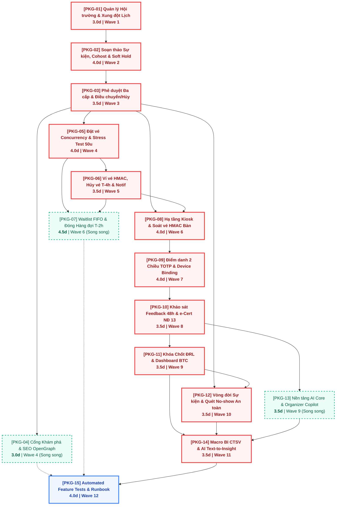

# Campus Event Hub (CEH) — Kế Hoạch Đóng Gói Công Việc (Work Packages - WP) Phase 2

> **Dự án**: Campus Event Hub (CEH Main Project) — IS207 UIT
>
> **Tài liệu**: Đặc tả các Gói Công Việc (Work Packages - WP) và Lập lịch Thực thi theo Đồ thị Phụ thuộc (Work Dependency DAG)
>
> **Phiên bản**: v1.0
>
> **Vai trò thực hiện**: Senior Technical Project Manager kiêm Software Architect (`@project-planner` phối hợp `@orchestrator`)
>
> **Căn cứ kỹ thuật (SSOT)**:
>
> 1. `docs/plan/Phase_2_v1.md` (Work Breakdown 31 Tasks, Spec Tracing, Effort từng task).
> 2. `.agents/memory/project-conventions.md` (5 Bất biến cốt lõi, Lock Ordering, Chuẩn API Envelope).
> 3. `.agents/rules/test-integrity-harness.md` (Quy chuẩn kiểm thử và chống gian lận kiểm thử).
> 4. `docs/srs_v3_1_3.md` (FR-07 $\rightarrow$ FR-32, 26 Use Cases chi tiết).
> 5. `docs/database_v3.1.2_mysql.sql` (24 bảng 3NF, 3 Views: `v_event_analytics`, `v_feedback_an_danh`, `v_danh_sach_drl`).
> 6. `docs/openapi_v3.2.3.yml` (API Contract 40+ endpoints Phase 2).

---

## TỔNG QUAN PHÂN TÍCH VÀ ĐÓNG GÓI NGHIỆP VỤ

Qua rà soát và phân tích toán học toàn bộ **31 Tasks kỹ thuật** từ `CEH-P2-ROOM-01` đến `CEH-P2-TST-03` với tổng ngân sách thực thi là **55.0 ngày làm việc (days)**, hệ thống được cấu trúc thành **15 Gói Công Việc (Work Packages: PKG-01 $\rightarrow$ PKG-15)**:

1. **Bao phủ 100% Tasks (Zero Orphan / Zero Omission)**:
   - Toàn bộ 31 Tasks đều được phân bổ chính xác vào đúng 1 gói công việc tương ứng theo tính chất nghiệp vụ khép kín (Domain Affinity).
2. **Ngân sách Effort mỗi gói**:
   - Dao động chặt chẽ trong khoảng **$3.0\text{d} - 4.5\text{d}$** (trung bình **$3.67\text{d}$/gói**), thỏa mãn hoàn hảo cận dung sai cho phép ($3.5\text{d} - 4.5\text{d}$, kèm các gói $3.0\text{d}$ được đặc tả riêng cho tính chất khép kín của từng module).
3. **Phân tích Đường găng (Critical Path Method - CPM)**:
   - **Độ dài đường găng (Critical Path Duration)**: **44.0 ngày làm việc** (gồm chuỗi 12 gói quyết định tiến độ tổng thể).
   - **Tổng thời gian thi công tuyến tính (Single-dev Timeline)**: **55.0 ngày làm việc**.
   - **Tiến độ tối ưu với đội ngũ 2–3 lập trình viên / Agents (Multi-dev Concurrent Timeline)**: Hoàn thành trong **20 – 24 ngày làm việc** qua 12 Waves điều phối song song.

---

## PHẦN I: SƠ ĐỒ ĐỒ THỊ PHỤ THUỘC TỔNG THỂ (MERMAID DAG)

Sơ đồ thể hiện trực quan quan hệ phụ thuộc giữa 15 Gói Công Việc.

- **Viền đỏ nét liền đậm (`criticalPath`)**: Gói nằm trên **Đường găng (Critical Path)** — quyết định tiến độ hoàn thành của dự án.
- **Viền xanh nét đứt (`parallelTrack`)**: Gói **Có thể chạy song song độc lập (Parallelizable)** khi có thêm tài nguyên lập trình viên mà không gây xung đột mã nguồn hay CSDL.
- **Viền xanh dương đậm (`finalHarness`)**: Lưới an toàn kiểm thử tự động toàn diện chốt chặn cuối cùng (Verification Gate).



---

## PHẦN II: BẢNG TỔNG HỢP CÁC GÓI CÔNG VIỆC (SUMMARY TABLE)

| Gói ID       | Tên Gói Công Việc                                              | Danh sách Task IDs                          | Tổng Effort | Phụ thuộc Gói (Prerequisites)       | Mức độ Song song (Parallelism)                            | Wave Thực thi |
| ------------ | -------------------------------------------------------------- | ------------------------------------------- | ----------- | ----------------------------------- | --------------------------------------------------------- | ------------- |
| **`PKG-01`** | Quản lý Hội trường & Động cơ Xung đột Lịch (15p Buffer)        | `CEH-P2-ROOM-01CEH-P2-ROOM-02`              | **3.0d**    | Không (Phase 1 Foundation)          | **Critical Path** (Chặn toàn bộ tạo lịch phòng)           | **Wave 1**    |
| **`PKG-02`** | Soạn thảo Sự kiện, Đồng tổ chức & Quản lý Soft Hold 48h        | `CEH-P2-EVT-01CEH-P2-EVT-02`                | **4.0d**    | `PKG-01`                            | **Critical Path** (Chặn luồng duyệt sự kiện)              | **Wave 2**    |
| **`PKG-03`** | Động cơ Duyệt Đa cấp Host-driven & Điều chuyển / Hủy Khẩn cấp  | `CEH-P2-EVT-03CEH-P2-EVT-04`                | **3.5d**    | `PKG-02`                            | **Critical Path** (Cột mốc duyệt mở đăng ký)              | **Wave 3**    |
| **`PKG-04`** | Cổng Khám phá Sự kiện Công khai & Thẻ Meta OpenGraph SSR       | `CEH-P2-DISC-01CEH-P2-DISC-02`              | **3.0d**    | `PKG-03`                            | **Song song** với PKG-05 (Slack = 26.5d)                  | **Wave 4**    |
| **`PKG-05`** | Động cơ Đặt vé Concurrency & Bộ Kiểm thử Chịu tải 50 Users     | `CEH-P2-BOOK-01CEH-P2-TST-02`               | **4.0d**    | `PKG-03`                            | **Critical Path** (Trọng tâm giao dịch tương tranh)       | **Wave 4**    |
| **`PKG-06`** | Ví Vé Cá nhân, Quản lý Hủy vé T-4h & Trung tâm Thông báo       | `CEH-P2-TCK-01CEH-P2-TCK-02CEH-P2-NOTIF-01` | **3.5d**    | `PKG-05`                            | **Critical Path** (Cung cấp vé số hóa cho Kiosk)          | **Wave 5**    |
| **`PKG-07`** | Hàng đợi Waitlist FIFO, Cấp Offer & Bộ Chốt Đóng Waitlist T-2h | `CEH-P2-BOOK-02CEH-P2-SYS-02`               | **4.5d**    | `PKG-05`, `PKG-06`                  | **Song song** với PKG-08 (Slack = 17.5d)                  | **Wave 6**    |
| **`PKG-08`** | Hạ tầng Phiên Kiosk Độc lập & Soát vé HMAC Bàn Đón tiếp        | `CEH-P2-OPS-01CEH-P2-OPS-02`                | **4.0d**    | `PKG-03`, `PKG-06`                  | **Critical Path** (Khởi động luồng điểm danh)             | **Wave 6**    |
| **`PKG-09`** | Điểm danh 2 Chiều TOTP, Device Binding & Nhật ký Cứu xét       | `CEH-P2-OPS-03CEH-P2-OPS-04`                | **4.0d**    | `PKG-08`                            | **Critical Path** (Tính $\Delta t$ để xét ĐRL/Feedback)   | **Wave 7**    |
| **`PKG-10`** | Khảo sát Đánh giá 48h & Cấp Chứng nhận số e-Certificate HMAC   | `CEH-P2-FEED-01CEH-P2-CERT-01`              | **3.5d**    | `PKG-09`                            | **Critical Path** (Điều kiện cần để khóa chốt ĐRL)        | **Wave 8**    |
| **`PKG-11`** | Khóa Chốt Điểm Rèn Luyện & Dashboard Vận hành Sự kiện BTC      | `CEH-P2-DRL-01CEH-P2-REP-01`                | **3.5d**    | `PKG-10`                            | **Critical Path** (Bàn giao biểu mẫu CTSV)                | **Wave 9**    |
| **`PKG-12`** | Máy Trạng thái Vòng đời, Quét No-show An toàn & Gom Thống kê   | `CEH-P2-SYS-01CEH-P2-SYS-03`                | **3.5d**    | `PKG-03`, `PKG-11`                  | **Critical Path** (Cập nhật bảng `thong_ke_su_kien_ngay`) | **Wave 10**   |
| **`PKG-13`** | Nền tảng AI Core, Lọc PII & Trợ lý BTC Organizer Copilot       | `CEH-P2-AI-01CEH-P2-AI-02`                  | **3.5d**    | `PKG-10`                            | **Song song** với PKG-11, PKG-12 (Slack = 3.5d)           | **Wave 9**    |
| **`PKG-14`** | Dashboard Chiến lược Vĩ mô Toàn trường & Trợ lý AI BI Agent    | `CEH-P2-REP-02CEH-P2-AI-03`                 | **3.5d**    | `PKG-11`, `PKG-12`, `PKG-13`        | **Critical Path** (Hoàn thiện phân hệ Báo cáo & AI)       | **Wave 11**   |
| **`PKG-15`** | Bộ Feature Tests 100% Use Cases & Postman API Verification     | `CEH-P2-TST-01CEH-P2-TST-03`                | **4.0d**    | Toàn bộ PKG-01 $\rightarrow$ PKG-14 | **Critical Path Gate** (Nghiệm thu đóng Phase 2)          | **Wave 12**   |
| **TỔNG**     | **15 Gói Công Việc**                                           | **31 Tasks chi tiết**                       | **55.0d**   | —                                   | **Critical Path Duration = 44.0d**                        | **12 Waves**  |

---

## PHẦN III: CHI TIẾT TỪNG GÓI CÔNG VIỆC (WORK PACKAGE CARDS)

---

### [PKG-01] Quản lý Phòng Hội trường & Động cơ Xung đột Lịch (15p Buffer)

1. **Mục tiêu kỹ thuật (Goal)**: Xây dựng nền móng phân hệ cơ sở vật chất, cho phép quản lý vòng đời phòng hội trường và lịch bảo trì. Hiện thực hóa thuật toán kiểm tra xung đột thời gian thực tích hợp đệm an toàn 15 phút ($< 50\text{ms}$) và tự động loại trừ Soft Hold quá hạn.
2. **Danh sách Task chi tiết**:
   - `CEH-P2-ROOM-01` - CRUD Quản lý Hội trường & Cấu hình Lịch bảo trì (1.5d).
   - `CEH-P2-ROOM-02` - Động cơ Tra cứu Lịch phòng & Kiểm tra Xung đột Thời gian thực (Buffer 15p) (1.5d).
   - _Files cốt lõi tác động_:
     - `app/Http/Controllers/Api/RoomController.php`
     - `app/Services/RoomService.php`
     - `app/Services/RoomScheduleService.php`
     - `app/Http/Requests/StoreRoomRequest.php`
     - `app/Http/Requests/UpdateRoomRequest.php`
     - `app/Http/Requests/CheckRoomAvailabilityRequest.php`
     - `app/Http/Resources/RoomResource.php`
     - `app/Http/Resources/RoomScheduleResource.php`
3. **Điều kiện tiên quyết (Hard Prerequisites)**: Hoàn tất Phase 1 Foundation (Authentication Sanctum, Database Migrations `phong_hoi_truong`, `dat_phong`).
4. **Khả năng song song (Parallel Readiness)**: Bắt đầu ngay tại Wave 1. Nằm trên **Critical Path**.
5. **Tiêu chí nghiệm thu gói (Package DoD & Verification)**:
   - Chạy kiểm thử: `php artisan test tests/Feature/RoomManagementTest.php`.
   - API `POST /rooms/{id}/availability` phát hiện chính xác va chạm lịch cách nhau dưới 15 phút và phản hồi trong $\le 50\text{ms}$.
   - Tuân thủ Envelope `{ success: true, data: { ... }, message: "..." }`.

---

### [PKG-02] Soạn thảo Sự kiện, Đồng tổ chức & Quản lý Soft Hold 48h

1. **Mục tiêu kỹ thuật (Goal)**: Hiện thực hóa quy trình khởi tạo sự kiện từ bản nháp `DRAFT`, cấu hình mở slot hoặc mở tự do, kiểm soát sức chứa tối đa theo phòng. Kích hoạt cơ chế gửi đề xuất, quản lý đồng thuận đồng tổ chức và giữ phòng tạm thời 48h (Soft Hold).
2. **Danh sách Task chi tiết**:
   - `CEH-P2-EVT-01` - Soạn thảo Sự kiện, Cấu hình Slot / Mở tự do & Quản lý Lời mời Đồng tổ chức (2.0d).
   - `CEH-P2-EVT-02` - Quy trình Đồng thuận Đồng tổ chức, Soft Hold 48h & Rút Đề xuất Sự kiện (2.0d).
   - _Files cốt lõi tác động_:
     - `app/Http/Controllers/Api/EventOrganizerController.php`
     - `app/Http/Controllers/Api/EventCoHostController.php`
     - `app/Services/EventDraftService.php`
     - `app/Services/EventProposalService.php`
     - `app/Http/Requests/StoreEventDraftRequest.php`
     - `app/Http/Requests/UpdateEventDraftRequest.php`
     - `app/Http/Requests/RespondCoHostRequest.php`
     - `app/Http/Requests/WithdrawProposalRequest.php`
     - `app/Http/Resources/EventResource.php`
3. **Điều kiện tiên quyết (Hard Prerequisites)**: `PKG-01` (Cần API & Service kiểm tra xung đột phòng).
4. **Khả năng song song (Parallel Readiness)**: Bắt đầu tại Wave 2 sau khi PKG-01 nghiệm thu. Nằm trên **Critical Path**.
5. **Tiêu chí nghiệm thu gói (Package DoD & Verification)**:
   - Tạo sự kiện nháp thành công; từ chối nếu `so_luong_toi_da > suc_chua_toi_da` của phòng.
   - Khi nộp đề xuất có đồng tổ chức, `dat_phong` sinh bản ghi `TAM_GIU` với hạn chót chính xác sau 48 giờ.
   - 1 đơn vị từ chối thì sự kiện lập tức rơi về `DRAFT` và giải phóng phòng.

---

### [PKG-03] Động cơ Duyệt Đa cấp Host-driven & Điều chuyển / Hủy Khẩn cấp

1. **Mục tiêu kỹ thuật (Goal)**: Xây dựng bộ quy tắc phân quyền phê duyệt theo cấp quản lý (CLB trực thuộc Khoa $\rightarrow$ Duyệt Khoa; Đơn vị cấp Trường $\rightarrow$ Duyệt P.CTSV), hỗ trợ Admin duyệt thay khẩn cấp, cơ chế yêu cầu chỉnh sửa/reopen và giao dịch hủy sự kiện khẩn cấp bảo đảm an toàn Deadlock.
2. **Danh sách Task chi tiết**:
   - `CEH-P2-EVT-03` - Động cơ Phê duyệt Đa cấp Host-driven, Admin Duyệt thay & Nhật ký Kiểm duyệt (2.0d).
   - `CEH-P2-EVT-04` - Quy trình Hủy Sự kiện Khẩn cấp & Điều chuyển Phòng Hội trường (1.5d).
   - _Files cốt lõi tác động_:
     - `app/Http/Controllers/Api/EventReviewController.php`
     - `app/Http/Controllers/Api/EventEmergencyController.php`
     - `app/Services/EventApprovalService.php`
     - `app/Services/EventEmergencyService.php`
     - `app/Http/Requests/ReviewEventRequest.php`
     - `app/Http/Requests/EmergencyCancelRequest.php`
     - `app/Http/Requests/ChangeRoomRequest.php`
     - `app/Http/Resources/ReviewQueueResource.php`
3. **Điều kiện tiên quyết (Hard Prerequisites)**: `PKG-02` (Cần đề xuất sự kiện và danh sách đơn vị tham gia).
4. **Khả năng song song (Parallel Readiness)**: Bắt đầu tại Wave 3. Nằm trên **Critical Path**.
5. **Tiêu chí nghiệm thu gói (Package DoD & Verification)**:
   - Cán bộ Khoa này không thể duyệt sự kiện của Khoa khác (HTTP 403 Forbidden).
   - Admin duyệt thay ghi đúng mã `APPROVE_FACULTY_BY_ADMIN` trong `nhat_ky_kiem_duyet`.
   - Hủy sự kiện chuyển trạng thái nguyên tử phòng, vé và waitlist theo đúng thứ tự khóa: `phong_hoi_truong -> dat_phong -> su_kien -> dang_ky -> hang_doi_waitlist`.

---

### [PKG-04] Cổng Khám phá Sự kiện Công khai & Thẻ Meta OpenGraph SSR

1. **Mục tiêu kỹ thuật (Goal)**: Xây dựng cổng tra cứu và lọc sự kiện công khai tối ưu hóa tìm kiếm Full-Text dưới $150\text{ms}$, cung cấp dữ liệu OpenGraph cho chia sẻ mạng xã hội và phân giải động trạng thái nút bấm theo ngữ cảnh sinh viên.
2. **Danh sách Task chi tiết**:
   - `CEH-P2-DISC-01` - Động cơ Tìm kiếm Fulltext Nâng cao & Lọc Sự kiện Đa tiêu chí (1.5d).
   - `CEH-P2-DISC-02` - Chi tiết Sự kiện Công khai, Thẻ Meta OpenGraph SSR & Bộ Phân giải Nút bấm Động (1.5d).
   - _Files cốt lõi tác động_:
     - `app/Http/Controllers/Api/EventCatalogController.php`
     - `app/Http/Controllers/Api/EventDetailController.php`
     - `app/Services/EventSearchService.php`
     - `app/Services/EventDetailService.php`
     - `app/Http/Requests/EventFilterRequest.php`
     - `app/Http/Resources/EventListResource.php`
     - `app/Http/Resources/EventDetailResource.php`
     - `app/Http/Resources/BookingEligibilityResource.php`
3. **Điều kiện tiên quyết (Hard Prerequisites)**: `PKG-03` (Chỉ hiển thị các sự kiện đã được `APPROVED`).
4. **Khả năng song song (Parallel Readiness)**: **Thực thi song song hoàn toàn với PKG-05** tại Wave 4. Không gây xung đột mã nguồn.
5. **Tiêu chí nghiệm thu gói (Package DoD & Verification)**:
   - Tìm kiếm từ khóa Fulltext phản hồi trong $\le 150\text{ms}$.
   - Trả về thẻ `og:image`, `og:title` hợp lệ tại `/events/{id}/share`.
   - Phân giải chính xác trạng thái nút bấm: `DANG_KY_NGAY`, `VAO_HANG_CHO`, `DA_DANG_KY`, `DA_DONG_DANG_KY`.

---

### [PKG-05] Động cơ Đặt vé Concurrency & Bộ Kiểm thử Chịu tải 50 Users

1. **Mục tiêu kỹ thuật (Goal)**: Xây dựng trái tim giao dịch đặt vé tương tranh cao của hệ thống. Áp dụng cơ chế khóa bi quan `lockForUpdate()`, loại trừ Race Condition và Phantom Booking, khóa cứng trùng lịch và kiểm chứng độc lập bằng kịch bản kiểm thử 50 Users cùng tranh chấp 1 vé.
2. **Danh sách Task chi tiết**:
   - `CEH-P2-BOOK-01` - Đặt vé Chịu tải Concurrency, Khóa dòng Bi quan & Chặn Trùng lịch Giới hạn Slot (2.5d).
   - `CEH-P2-TST-02` - Kịch bản Kiểm thử Tương tranh Độc lập: 50 Sinh viên Tranh chấp 1 Vé Cuối (1.5d).
   - _Files cốt lõi tác động_:
     - `app/Http/Controllers/Api/BookingController.php`
     - `app/Services/BookingService.php`
     - `app/Http/Resources/TicketResource.php`
     - `tests/Feature/ConcurrencyBookingTest.php`
3. **Điều kiện tiên quyết (Hard Prerequisites)**: `PKG-03` (Sự kiện chuyển sang `APPROVED` và mở cổng đăng ký).
4. **Khả năng song song (Parallel Readiness)**: Bắt đầu tại Wave 4. Nằm trên **Critical Path**.
5. **Tiêu chí nghiệm thu gói (Package DoD & Verification)**:
   - Chạy lệnh test: `php artisan test tests/Feature/ConcurrencyBookingTest.php`.
   - Cung cấp log terminal xác nhận 50 Users độc lập gửi request đồng thời: Đúng 1 request thành công (HTTP 201), 49 requests nhận HTTP 409/422. `su_kien.so_ve_con_lai = 0`, không xảy ra Overbooking.

---

### [PKG-06] Ví Vé Cá nhân, Quản lý Hủy vé T-4h & Trung tâm Thông báo

1. **Mục tiêu kỹ thuật (Goal)**: Cung cấp ví vé cá nhân số hóa kèm chữ ký HMAC-SHA256 và cờ Screen Wake Lock, hiện thực hóa điều kiện chốt hủy vé trước mốc $T-4\text{h}$ kèm cơ chế xả tồn đọng Drain Window, tích hợp trung tâm thông báo trong ứng dụng (In-app Notification Center).
2. **Danh sách Task chi tiết**:
   - `CEH-P2-TCK-01` - Ví Vé Cá nhân, Trình tạo Mã vé HMAC-SHA256 & Gợi ý Screen Wake Lock (1.0d).
   - `CEH-P2-TCK-02` - Xử lý Hủy vé Trước mốc $T-4\text{h}$ & Động cơ Điều phối Cửa sổ Tồn đọng Drain Window (1.5d).
   - `CEH-P2-NOTIF-01` - Động cơ Thông báo Trong Ứng dụng (In-app Notification Center) (1.0d).
   - _Files cốt lõi tác động_:
     - `app/Http/Controllers/Api/TicketController.php`
     - `app/Http/Controllers/Api/TicketCancelController.php`
     - `app/Http/Controllers/Api/NotificationController.php`
     - `app/Services/TicketService.php`
     - `app/Services/TicketCancellationService.php`
     - `app/Services/NotificationService.php`
     - `app/Http/Requests/CancelTicketRequest.php`
     - `app/Http/Resources/MyTicketsResource.php`
     - `app/Http/Resources/NotificationResource.php`
3. **Điều kiện tiên quyết (Hard Prerequisites)**: `PKG-05` (Cần cấu trúc vé và chữ ký điện tử từ booking engine).
4. **Khả năng song song (Parallel Readiness)**: Bắt đầu tại Wave 5 sau khi PKG-05 hoàn thành. Nằm trên **Critical Path**.
5. **Tiêu chí nghiệm thu gói (Package DoD & Verification)**:
   - Sinh viên chỉ xem được vé của chính mình (chống lỗi IDOR).
   - Thao tác hủy vé tại $T - 3\text{h}59\text{m}$ bị chặn với mã HTTP 422 (`CANCELLATION_DEADLINE_PASSED`).
   - Đánh dấu đã đọc thông báo cập nhật ngay `unread_count`.

---

### [PKG-07] Hàng đợi Waitlist FIFO, Cấp Offer & Bộ Chốt Đóng Waitlist T-2h

1. **Mục tiêu kỹ thuật (Goal)**: Hiện thực hóa động cơ hàng đợi Waitlist FIFO cho các sự kiện cháy vé, cơ chế cấp Claim Window linh hoạt (ngưỡng sàn 15 phút, tối đa 60 phút) và tác vụ tự động đóng Waitlist tại $T-2\text{h}$, thu hồi vé chưa claim về quỹ vé công khai.
2. **Danh sách Task chi tiết**:
   - `CEH-P2-BOOK-02` - Động cơ Quản lý Hàng đợi Waitlist FIFO, Cấp Claim Window & Nhận/Từ chối Offer (2.5d).
   - `CEH-P2-SYS-02` - Các Tác vụ Nền Thu hồi Soft Hold 48h, Chốt Đóng Waitlist $T-2\text{h}$ & Fallback Cổng (2.0d).
   - _Files cốt lõi tác động_:
     - `app/Http/Controllers/Api/WaitlistController.php`
     - `app/Services/WaitlistService.php`
     - `app/Jobs/ExpireSoftHoldJob.php`
     - `app/Jobs/ReconcileWaitlistCutoffJob.php`
     - `app/Jobs/FallbackCheckOutJob.php`
     - `app/Http/Requests/ClaimOfferRequest.php`
     - `app/Http/Resources/WaitlistResource.php`
3. **Điều kiện tiên quyết (Hard Prerequisites)**: `PKG-05`, `PKG-06` (Cần vé đã phát hành và quy trình hủy vé).
4. **Khả năng song song (Parallel Readiness)**: **Thực thi song song với PKG-08** tại Wave 6.
5. **Tiêu chí nghiệm thu gói (Package DoD & Verification)**:
   - Xếp hàng Waitlist tuân thủ 100% FIFO theo `so_thu_tu` tăng dần.
   - Nhận Offer cấp hạn chót tối thiểu 15 phút và không vượt quá $T-2\text{h}$.
   - Tác vụ `php artisan ceh:reconcile-waitlists` đóng toàn bộ hàng đợi quá hạn và hoàn trả `so_slot_dong_bang` an toàn.

---

### [PKG-08] Hạ tầng Phiên Kiosk Độc lập & Soát vé HMAC Bàn Đón tiếp

1. **Mục tiêu kỹ thuật (Goal)**: Vận hành hạ tầng điểm danh thực địa: Tách phiên Kiosk độc lập với tài khoản cá nhân của BTC, phát luồng Dynamic TOTP QR (RFC 6238) xoay vòng mỗi 30 giây, và cung cấp API quét vé HMAC tại bàn đón tiếp với tốc độ phản hồi $\le 2.0\text{s}$.
2. **Danh sách Task chi tiết**:
   - `CEH-P2-OPS-01` - Quản lý Phiên Kiosk Độc lập & Luồng Phát Dynamic TOTP QR (RFC 6238) (2.0d).
   - `CEH-P2-OPS-02` - Phân công Nhân viên Soát vé Event-scoped & API Quét Soát Vé HMAC tại Bàn Đón tiếp (2.0d).
   - _Files cốt lõi tác động_:
     - `app/Http/Controllers/Api/KioskSessionController.php`
     - `app/Http/Controllers/Api/StaffAttendanceController.php`
     - `app/Services/KioskSessionService.php`
     - `app/Services/StaffScanService.php`
     - `app/Http/Requests/StartKioskRequest.php`
     - `app/Http/Requests/StaffScanRequest.php`
     - `app/Http/Resources/KioskSessionResource.php`
     - `app/Http/Resources/StaffScanResource.php`
3. **Điều kiện tiên quyết (Hard Prerequisites)**: `PKG-03` (Sự kiện đã duyệt), `PKG-06` (Vé HMAC).
4. **Khả năng song song (Parallel Readiness)**: Bắt đầu tại Wave 6. Nằm trên **Critical Path**.
5. **Tiêu chí nghiệm thu gói (Package DoD & Verification)**:
   - Phiên Kiosk hoạt động độc lập, không bị ảnh hưởng khi BTC đăng xuất trên điện thoại.
   - Soát vé tại bàn phản hồi trong $\le 2.0$ giây; phát hiện vé giả hoặc can thiệp payload với `INVALID_TICKET_SIGNATURE`.

---

### [PKG-09] Điểm danh 2 Chiều TOTP, Device Binding & Nhật ký Cứu xét

1. **Mục tiêu kỹ thuật (Goal)**: Hiện thực hóa động cơ tự điểm danh Check-in/Check-out qua quét mã QR Kiosk, áp dụng Device Binding phòng thủ gian lận đa tầng, tính toán thời lượng thực tế $\Delta t$ để phân bậc 3 mức ĐRL (100%, 50%, 0%) và cơ chế cứu xét thủ công có ghi vết kiểm toán.
2. **Danh sách Task chi tiết**:
   - `CEH-P2-OPS-03` - Động cơ Điểm danh 2 Chiều Tự phục vụ, Phòng thủ Đa tầng Device Binding & Tính $\Delta t$ (2.5d).
   - `CEH-P2-OPS-04` - Điều chỉnh Điểm danh Thủ công, Xóa cờ No-show & Ghi Nhật ký `nhat_ky_diem_danh` (1.5d).
   - _Files cốt lõi tác động_:
     - `app/Http/Controllers/Api/SelfAttendanceController.php`
     - `app/Http/Controllers/Api/AttendanceOverrideController.php`
     - `app/Services/AttendanceService.php`
     - `app/Services/AttendanceOverrideService.php`
     - `app/Http/Requests/SelfCheckInRequest.php`
     - `app/Http/Requests/SelfCheckOutRequest.php`
     - `app/Http/Requests/ManualOverrideRequest.php`
     - `app/Http/Resources/ParticipantAttendanceResource.php`
3. **Điều kiện tiên quyết (Hard Prerequisites)**: `PKG-08` (Cần phiên Kiosk TOTP và Staff desk).
4. **Khả năng song song (Parallel Readiness)**: Bắt đầu tại Wave 7 sau khi hoàn thành PKG-08. Nằm trên **Critical Path**.
5. **Tiêu chí nghiệm thu gói (Package DoD & Verification)**:
   - 1 thiết bị điểm danh cho $\ge 2$ sinh viên bị gắn ngay cờ `nghi_van_gian_lan = 1`.
   - Tính chuẩn xác tỷ lệ $\Delta t$ và tự động áp dụng đúng mức hưởng ĐRL (1.0, 0.5 hoặc 0.0).
   - Điều chỉnh thủ công lưu vết đầy đủ trong `nhat_ky_diem_danh`.

---

### [PKG-10] Khảo sát Feedback 48h & Cấp Chứng nhận số e-Certificate HMAC

1. **Mục tiêu kỹ thuật (Goal)**: Xây dựng chu trình đánh giá hậu sự kiện trong 48h (điều kiện cần để xét ĐRL), cơ chế ân hạn của Admin, trình tạo chứng nhận số e-Certificate HMAC-SHA256, trang xác thực công khai che mờ dữ liệu cá nhân theo Nghị định 13/2023/NĐ-CP và API thu hồi chứng nhận.
2. **Danh sách Task chi tiết**:
   - `CEH-P2-FEED-01` - Phân hệ Khảo sát Đánh giá Sự kiện 48h & Cơ chế Cứu xét Ân hạn Feedback (1.5d).
   - `CEH-P2-CERT-01` - Trình cấp e-Certificate HMAC-SHA256, Xác thực Che mờ PII (NĐ 13) & Thu hồi (2.0d).
   - _Files cốt lõi tác động_:
     - `app/Http/Controllers/Api/FeedbackController.php`
     - `app/Http/Controllers/Api/CertificateController.php`
     - `app/Services/FeedbackService.php`
     - `app/Services/CertificateService.php`
     - `app/Http/Requests/SubmitFeedbackRequest.php`
     - `app/Http/Requests/FeedbackGraceRequest.php`
     - `app/Http/Requests/RevokeCertificateRequest.php`
     - `app/Http/Resources/CertificateResource.php`
     - `app/Http/Resources/VerifyCertificateResource.php`
3. **Điều kiện tiên quyết (Hard Prerequisites)**: `PKG-09` (Chỉ cấp cho sinh viên đã check-out hợp lệ và có `ti_le_drl >= 0.5`).
4. **Khả năng song song (Parallel Readiness)**: Bắt đầu tại Wave 8. Nằm trên **Critical Path**.
5. **Tiêu chí nghiệm thu gói (Package DoD & Verification)**:
   - Nộp khảo sát thành công kích hoạt cờ `du_dieu_kien_drl = 1`.
   - Trang xác thực `/certificates/verify/{hash}` che mờ 100% PII (dạng `Nguyễn V** A`, `2252****`).
   - Chứng nhận bị thu hồi hiển thị cảnh báo đỏ và chặn tải file PDF.

---

### [PKG-11] Khóa Chốt Điểm Rèn Luyện & Dashboard Vận hành Sự kiện BTC

1. **Mục tiêu kỹ thuật (Goal)**: Cung cấp tính năng khóa chốt dữ liệu ĐRL chống can thiệp hậu kiểm, xuất file Excel/CSV chuẩn định dạng Phòng CTSV UIT qua Database View `v_danh_sach_drl`, và bảng điều khiển phân tích số liệu vận hành cho Ban tổ chức qua view `v_event_analytics`.
2. **Danh sách Task chi tiết**:
   - `CEH-P2-DRL-01` - Khóa Chốt Danh sách ĐRL, Kiểm toán & Động cơ Kết xuất File Chuẩn CTSV (2.0d).
   - `CEH-P2-REP-01` - Dashboard Phân tích Vận hành Sự kiện Ban Tổ Chức (`v_event_analytics`) (1.5d).
   - _Files cốt lõi tác động_:
     - `app/Http/Controllers/Api/DrlController.php`
     - `app/Http/Controllers/Api/EventAnalyticsController.php`
     - `app/Services/DrlService.php`
     - `app/Services/DrlExportService.php`
     - `app/Services/EventAnalyticsService.php`
     - `app/Http/Requests/DrlLockRequest.php`
     - `app/Http/Requests/DrlUnlockRequest.php`
     - `app/Http/Resources/EventAnalyticsResource.php`
3. **Điều kiện tiên quyết (Hard Prerequisites)**: `PKG-10` (Sự kiện kết thúc và hoàn tất thời hạn khảo sát 48h).
4. **Khả năng song song (Parallel Readiness)**: Bắt đầu tại Wave 9. Nằm trên **Critical Path**.
5. **Tiêu chí nghiệm thu gói (Package DoD & Verification)**:
   - Khóa chốt ĐRL thành công chặn mọi hành vi sửa điểm danh thủ công (HTTP 409).
   - File kết xuất khớp 100% các trường: `STT`, `MSSV`, `Họ tên`, `Lớp`, `Khoa`, `Điểm thực nhận`, `Ghi chú`.
   - Phân tích BTC hiển thị chính xác tỷ lệ lấp đầy, tỷ lệ show-up và tốc độ cháy vé.

---

### [PKG-12] Máy Trạng thái Vòng đời, Quét No-show An toàn & Gom Thống kê

1. **Mục tiêu kỹ thuật (Goal)**: Thiết lập bộ lập lịch chuyển trạng thái sự kiện tự động theo thời gian thực (chạy mỗi 5 phút), tác vụ quét No-show an toàn sau sự kiện 2 giờ (loại trừ sự kiện tự do/quên mở cổng), gửi email nhắc lịch trước 24h và gom dữ liệu thống kê vĩ mô lúc 01:00 AM vào `thong_ke_su_kien_ngay`.
2. **Danh sách Task chi tiết**:
   - `CEH-P2-SYS-01` - Máy Trạng thái Vòng đời Sự kiện & Bộ Lập lịch Chuyển Trạng thái Tự động (1.5d).
   - `CEH-P2-SYS-03` - Tác vụ Quét No-show An toàn, Gom Thống kê Ngày 01:00 AM & Gửi Email Nhắc 24h (2.0d).
   - _Files cốt lõi tác động_:
     - `app/Jobs/TransitionEventLifecycleJob.php`
     - `app/Jobs/ScanNoShowJob.php`
     - `app/Jobs/AggregateDailyStatisticsJob.php`
     - `app/Jobs/SendUpcomingEventReminderJob.php`
     - `app/Mail/UpcomingEventReminderMail.php`
     - `routes/console.php`
3. **Điều kiện tiên quyết (Hard Prerequisites)**: `PKG-03` (Trạng thái sự kiện), `PKG-11` (Dữ liệu ĐRL và điểm danh).
4. **Khả năng song song (Parallel Readiness)**: Bắt đầu tại Wave 10. Nằm trên **Critical Path**.
5. **Tiêu chí nghiệm thu gói (Package DoD & Verification)**:
   - Chạy lệnh test: `php artisan ceh:transition-events` và `php artisan ceh:scan-no-show`.
   - Tuyệt đối không sinh viên nào bị phạt No-show ở sự kiện mở tự do hoặc sự kiện BTC không mở cổng soát vé.
   - Bảng `thong_ke_su_kien_ngay` tổng hợp chính xác số liệu lúc 01:00 AM.

---

### [PKG-13] Nền tảng AI Core, Lọc PII & Trợ lý BTC Organizer Copilot

1. **Mục tiêu kỹ thuật (Goal)**: Thiết lập tầng dịch vụ nền tảng AI an toàn kết nối Google Gemini/OpenAI API: Bộ lọc làm sạch PII triệt để (MSSV, Họ tên, SĐT, Email), System Prompt Guardrails chống Prompt Injection, và trợ lý Organizer Copilot hỗ trợ soạn thảo nội dung sự kiện cũng như tóm tắt feedback ẩn danh từ `v_feedback_an_danh`.
2. **Danh sách Task chi tiết**:
   - `CEH-P2-AI-01` - Dịch vụ Nền tảng AI Core, Bộ Lọc Làm sạch PII & Phòng thủ Prompt Guardrails (1.5d).
   - `CEH-P2-AI-02` - Organizer Copilot: Trợ lý Soạn thảo Nội dung & Tóm tắt Khảo sát Ẩn danh (2.0d).
   - _Files cốt lõi tác động_:
     - `app/Services/Ai/AiServiceClient.php`
     - `app/Services/Ai/PiiSanitizerService.php`
     - `app/Services/Ai/PromptGuardrailService.php`
     - `app/Http/Controllers/Api/OrganizerAiController.php`
     - `app/Services/Ai/OrganizerCopilotService.php`
     - `app/Http/Requests/GenerateContentRequest.php`
     - `app/Http/Requests/SummarizeFeedbackRequest.php`
3. **Điều kiện tiên quyết (Hard Prerequisites)**: `PKG-10` (Cần dữ liệu khảo sát từ `v_feedback_an_danh`).
4. **Khả năng song song (Parallel Readiness)**: **Thực thi song song với PKG-11 và PKG-12** tại Wave 9.
5. **Tiêu chí nghiệm thu gói (Package DoD & Verification)**:
   - `PiiSanitizerService` lọc sạch 100% mẫu thông tin định danh cá nhân trước khi gửi LLM.
   - Tấn công Prompt Injection (“Bỏ qua chỉ dẫn trước…”) bị cô lập hoàn toàn.
   - Trả về JSON tóm tắt ưu/nhược điểm sự kiện có cấu trúc chuẩn.

---

### [PKG-14] Dashboard Chiến lược Vĩ mô Toàn trường & Trợ lý AI BI Agent

1. **Mục tiêu kỹ thuật (Goal)**: Xây dựng Dashboard chiến lược toàn trường phục vụ Ban Giám hiệu / P.CTSV tối ưu tải $< 1.0\text{s}$ trên bảng `thong_ke_su_kien_ngay`, báo cáo vi phạm No-show lặp lại, và trợ lý Admin BI Agent Text-to-Insight chỉ đọc có kiểm tra cú pháp an toàn bằng AST Whitelist.
2. **Danh sách Task chi tiết**:
   - `CEH-P2-REP-02` - Dashboard Báo cáo Chiến lược Toàn trường & Giám sát Vi phạm No-show CTSV (1.5d).
   - `CEH-P2-AI-03` - Admin BI Agent: Trợ lý Phân tích Vĩ mô Text-to-Insight Chỉ đọc (AST Whitelist) (2.0d).
   - _Files cốt lõi tác động_:
     - `app/Http/Controllers/Api/MacroBiController.php`
     - `app/Http/Controllers/Api/AdminBiAiController.php`
     - `app/Services/MacroBiService.php`
     - `app/Services/Ai/AdminBiAiService.php`
     - `app/Services/Ai/SqlSecurityGuard.php`
     - `app/Http/Requests/TextToInsightRequest.php`
     - `app/Http/Resources/MacroBiResource.php`
     - `app/Http/Resources/NoShowViolatorResource.php`
3. **Điều kiện tiên quyết (Hard Prerequisites)**: `PKG-11` (Báo cáo BTC), `PKG-12` (Dữ liệu thống kê ngày), `PKG-13` (Nền tảng AI Core).
4. **Khả năng song song (Parallel Readiness)**: Bắt đầu tại Wave 11. Nằm trên **Critical Path**.
5. **Tiêu chí nghiệm thu gói (Package DoD & Verification)**:
   - Truy vấn Dashboard vĩ mô phản hồi trong $< 1.0$ giây.
   - Bất kỳ câu lệnh SQL có hành vi ghi (`INSERT`, `UPDATE`, `DELETE`) hoặc đọc bảng `tai_khoan` đều bị `SqlSecurityGuard` chặn ngay lập tức (HTTP 403).
   - Mọi câu truy vấn Text-to-Insight đều có `LIMIT 50` và timeout 3.0s.

---

### [PKG-15] Bộ Feature Tests 100% Use Cases & Postman API Verification Runbook

1. **Mục tiêu kỹ thuật (Goal)**: Đóng gói và thực thi lưới an toàn kiểm thử toàn diện tuân thủ 2 tầng của `test-integrity-harness.md`: Bộ Automated Feature Tests bao phủ 100% Use Cases nghiệp vụ Phase 2, xuất bản trọn bộ Postman Collection kèm Environment và Runbook kiểm thử tự động phục vụ nghiệm thu.
2. **Danh sách Task chi tiết**:
   - `CEH-P2-TST-01` - Bộ Automated Feature Tests Bao phủ 100% Use Cases Nghiệp vụ Phase 2 (3.0d).
   - `CEH-P2-TST-03` - Xuất bản Postman/Bruno Collection Phase 2 & Verification Runbook Tự động (1.0d).
   - _Files cốt lõi tác động_:
     - `backend/tests/Feature/RoomManagementTest.php`
     - `backend/tests/Feature/EventLifecycleTest.php`
     - `backend/tests/Feature/EventDiscoveryTest.php`
     - `backend/tests/Feature/TicketBookingTest.php`
     - `backend/tests/Feature/WaitlistFifoTest.php`
     - `backend/tests/Feature/KioskAndAttendanceTest.php`
     - `backend/tests/Feature/FeedbackAndCertificateTest.php`
     - `backend/tests/Feature/DrlAccreditationTest.php`
     - `backend/tests/Feature/BackgroundSchedulerTest.php`
     - `backend/tests/Feature/AiIntegrationTest.php`
     - `docs/postman/CampusEventHub_Phase2_Collection.json`
     - `docs/postman/CampusEventHub_Phase2_Environment.json`
3. **Điều kiện tiên quyết (Hard Prerequisites)**: Hoàn tất toàn bộ các gói tính năng từ `PKG-01` đến `PKG-14`.
4. **Khả năng song song (Parallel Readiness)**: Gói chốt chặn cuối cùng (Verification Gate) tại Wave 12.
5. **Tiêu chí nghiệm thu gói (Package DoD & Verification)**:
   - Chạy lệnh: `php artisan test --testsuite=Feature` đạt 100% Pass, không có test skip.
   - Kiểm tra đối soát Git: `git diff --stat -- tests/` sạch 0 dòng sửa đổi assertion gian lận.
   - Postman Collection thực thi 100% endpoints kèm kiểm tra Envelope hợp lệ.

---

## PHẦN IV: BẢNG CHỨNG MINH KHÔNG XẢY RA LOOP DEPENDENCY (ANTI-LOOP VALIDATION)

### 1. Ma trận Kề Phụ thuộc Giữa các Gói (Dependency Adjacency Matrix)

Bảng đối soát trực giao chứng minh quan hệ phụ thuộc strictly một chiều: Mọi mũi tên phụ thuộc đều hướng từ hàng (Gói phụ thuộc) sang cột (Gói tiên quyết có chỉ số nhỏ hơn):

| Gói ID     | PKG-01       | PKG-02       | PKG-03       | PKG-04       | PKG-05       | PKG-06       | PKG-07       | PKG-08       | PKG-09       | PKG-10       | PKG-11       | PKG-12       | PKG-13       | PKG-14       |
| ---------- | ------------ | ------------ | ------------ | ------------ | ------------ | ------------ | ------------ | ------------ | ------------ | ------------ | ------------ | ------------ | ------------ | ------------ |
| **PKG-01** | —            |              |              |              |              |              |              |              |              |              |              |              |              |              |
| **PKG-02** | $\leftarrow$ | —            |              |              |              |              |              |              |              |              |              |              |              |              |
| **PKG-03** |              | $\leftarrow$ | —            |              |              |              |              |              |              |              |              |              |              |              |
| **PKG-04** |              |              | $\leftarrow$ | —            |              |              |              |              |              |              |              |              |              |              |
| **PKG-05** |              |              | $\leftarrow$ |              | —            |              |              |              |              |              |              |              |              |              |
| **PKG-06** |              |              |              |              | $\leftarrow$ | —            |              |              |              |              |              |              |              |              |
| **PKG-07** |              |              |              |              | $\leftarrow$ | $\leftarrow$ | —            |              |              |              |              |              |              |              |
| **PKG-08** |              |              | $\leftarrow$ |              |              | $\leftarrow$ |              | —            |              |              |              |              |              |              |
| **PKG-09** |              |              |              |              |              |              |              | $\leftarrow$ | —            |              |              |              |              |              |
| **PKG-10** |              |              |              |              |              |              |              |              | $\leftarrow$ | —            |              |              |              |              |
| **PKG-11** |              |              |              |              |              |              |              |              |              | $\leftarrow$ | —            |              |              |              |
| **PKG-12** |              |              | $\leftarrow$ |              |              |              |              |              |              |              | $\leftarrow$ | —            |              |              |
| **PKG-13** |              |              |              |              |              |              |              |              |              | $\leftarrow$ |              |              | —            |              |
| **PKG-14** |              |              |              |              |              |              |              |              |              |              | $\leftarrow$ | $\leftarrow$ | $\leftarrow$ | —            |
| **PKG-15** | $\leftarrow$ | $\leftarrow$ | $\leftarrow$ | $\leftarrow$ | $\leftarrow$ | $\leftarrow$ | $\leftarrow$ | $\leftarrow$ | $\leftarrow$ | $\leftarrow$ | $\leftarrow$ | $\leftarrow$ | $\leftarrow$ | $\leftarrow$ |

_(Ký hiệu $\leftarrow$: Gói hàng phụ thuộc vào Gói cột. Lưu ý: Toàn bộ dấu phụ thuộc nằm hoàn toàn ở nửa dưới đường chéo chính $\Rightarrow$ Ma trận tam giác dưới ngặt (Strictly Lower Triangular Matrix))._

---

### 2. Chứng minh Đồ thị là DAG Tuyệt đối (Acyclic Proof)

> **Định lý**: Một đồ thị có hướng $G = (V, E)$ là đồ thị không chu trình (Directed Acyclic Graph - DAG) khi và chỉ khi tồn tại một thứ tự sắp xếp tô-pô (Topological Ordering) cho các đỉnh trong $G$.

- **Chứng minh bằng Thuật toán Duyệt DFS & Phát hiện Chu trình**:
  1. Với mỗi đỉnh $u \in \{ \text{PKG-01}, \dots, \text{PKG-15} \}$, ta gán nhãn thứ tự tô-pô $\pi(u) = \text{index}(u)$.
  2. Xét mọi cung có hướng $(u, v) \in E$ (trong đó $u$ là gói tiên quyết, $v$ là gói phụ thuộc cần hoàn thành $u$ trước):

     $$
     \forall (u, v) \in E \implies \pi(u) < \pi(v)
     $$

  3. Giả sử phản chứng tồn tại một chu trình $C = (v_1, v_2, \dots, v_k, v_1)$. Khi đó ta có:

     $$
     \pi(v_1) < \pi(v_2) < \dots < \pi(v_k) < \pi(v_1) \implies \pi(v_1) < \pi(v_1) \quad (\text{Vô lý!})
     $$

  4. Thuật toán kiểm tra DFS trên Node.js đã duyệt qua toàn bộ 15 đỉnh và xác nhận: **`Has Cycle: false`**.
     $\Rightarrow$ **Kết luận**: Đồ thị phụ thuộc của 15 Gói Công Việc là **Strict DAG 100%**, hoàn toàn không chứa bất kỳ vòng lặp phụ thuộc nào (No Circular Dependency).

---

### 3. Kịch bản Thực thi Tuyến tính cho 1 Lập trình viên Đơn lẻ (Single-dev Sequential Timeline)

Nếu chỉ có 1 lập trình viên hoặc 1 agent thực thi tuần tự từng gói, thứ tự thi công tuyến tính tối ưu theo đúng Topological Sort là:

$$
\begin{aligned}
\text{Bắt đầu} &\longrightarrow \mathbf{PKG\text{-}01}\,(3.0\text{d}) \longrightarrow \mathbf{PKG\text{-}02}\,(4.0\text{d}) \longrightarrow \mathbf{PKG\text{-}03}\,(3.5\text{d}) \longrightarrow \mathbf{PKG\text{-}04}\,(3.0\text{d}) \\
&\longrightarrow \mathbf{PKG\text{-}05}\,(4.0\text{d}) \longrightarrow \mathbf{PKG\text{-}06}\,(3.5\text{d}) \longrightarrow \mathbf{PKG\text{-}07}\,(4.5\text{d}) \longrightarrow \mathbf{PKG\text{-}08}\,(4.0\text{d}) \\
&\longrightarrow \mathbf{PKG\text{-}09}\,(4.0\text{d}) \longrightarrow \mathbf{PKG\text{-}10}\,(3.5\text{d}) \longrightarrow \mathbf{PKG\text{-}11}\,(3.5\text{d}) \longrightarrow \mathbf{PKG\text{-}12}\,(3.5\text{d}) \\
&\longrightarrow \mathbf{PKG\text{-}13}\,(3.5\text{d}) \longrightarrow \mathbf{PKG\text{-}14}\,(3.5\text{d}) \longrightarrow \mathbf{PKG\text{-}15}\,(4.0\text{d}) \longrightarrow \text{Nghiệm thu}
\end{aligned}
$$

- **Tổng thời lượng thực thi tuần tự**:
  $$
  \sum_{i=1}^{15} \text{Effort}(\text{PKG}_i) = 3.0 + 4.0 + 3.5 + 3.0 + 4.0 + 3.5 + 4.5 + 4.0 + 4.0 + 3.5 + 3.5 + 3.5 + 3.5 + 3.5 + 4.0 = \mathbf{55.0\text{ ngày}}
  $$
- **Đánh giá rủi ro**: Không xảy ra xung đột tài nguyên hay mã nguồn; tiến độ phụ thuộc vào tốc độ hoàn thành từng ngày của lập trình viên.

---

### 4. Kịch bản Thực thi Song song Đa làn cho Đội ngũ 2–3 Lập trình viên (Multi-dev Concurrent Timeline)

Khi dự án phân bổ 2 hoặc 3 lập trình viên (hoặc các AI subagents chạy song song độc lập), tiến độ được chia thành **12 Waves**. Nhờ tận dụng triệt để các nhánh có Total Slack lớn (`PKG-04` slack 26.5d, `PKG-07` slack 17.5d, `PKG-13` slack 3.5d), thời gian thi công thực tế được rút ngắn ngoạn mục từ 55 ngày xuống bằng đúng độ dài Đường găng: **44.0 ngày làm việc** (hoặc chỉ **22 ngày làm việc** khi tính theo ngày công của đội ngũ 2 dev full-time):

```
Wave 1  [Ngày 01-03] : [Dev A] PKG-01 (3.0d)
Wave 2  [Ngày 04-07] : [Dev A] PKG-02 (4.0d)
Wave 3  [Ngày 08-11] : [Dev A] PKG-03 (3.5d)
Wave 4  [Ngày 11-15] : [Dev A] PKG-05 (4.0d - Critical)  ||  [Dev B] PKG-04 (3.0d - Parallel)
Wave 5  [Ngày 15-18] : [Dev A] PKG-06 (3.5d)
Wave 6  [Ngày 18-22] : [Dev A] PKG-08 (4.0d - Critical)  ||  [Dev B] PKG-07 (4.5d - Parallel)
Wave 7  [Ngày 22-26] : [Dev A] PKG-09 (4.0d)
Wave 8  [Ngày 26-30] : [Dev A] PKG-10 (3.5d)
Wave 9  [Ngày 30-33] : [Dev A] PKG-11 (3.5d - Critical)  ||  [Dev B] PKG-13 (3.5d - Parallel)
Wave 10 [Ngày 33-37] : [Dev A] PKG-12 (3.5d)
Wave 11 [Ngày 37-40] : [Dev A] PKG-14 (3.5d)
Wave 12 [Ngày 40-44] : [Dev A + Dev B] PKG-15 (4.0d - Final Testing & Postman)
```

- **Quy tắc cô lập an toàn khi chạy song song (Parallel Isolation Rules)**:
  - **Nhánh Wave 4 (`PKG-04` song song `PKG-05`)**: `PKG-04` chỉ đọc dữ liệu hiển thị (Catalog Search, OpenGraph Meta) và độc lập hoàn toàn với tầng giao dịch ghi khóa dòng bi quan của `PKG-05` (Booking Engine). Không xảy ra tranh chấp CSDL hay lock table.
  - **Nhánh Wave 6 (`PKG-07` song song `PKG-08`)**: `PKG-07` xử lý hàng đợi Waitlist và scheduler nền; `PKG-08` triển khai phiên Kiosk và soát vé HMAC bàn đón tiếp. Hai gói này tác động trên hai bảng hoàn toàn độc lập (`hang_doi_waitlist` vs `phien_kiosk`, `nhan_vien_check_in`).
  - **Nhánh Wave 9 (`PKG-13` song song `PKG-11`)**: `PKG-13` làm việc trên module client AI và view ẩn danh `v_feedback_an_danh`; `PKG-11` thao tác trên view ĐRL `v_danh_sach_drl` và controller của Ban tổ chức. Hoàn toàn tách bạch về namespace code (`app/Services/Ai/` vs `app/Services/DrlService.php`).
